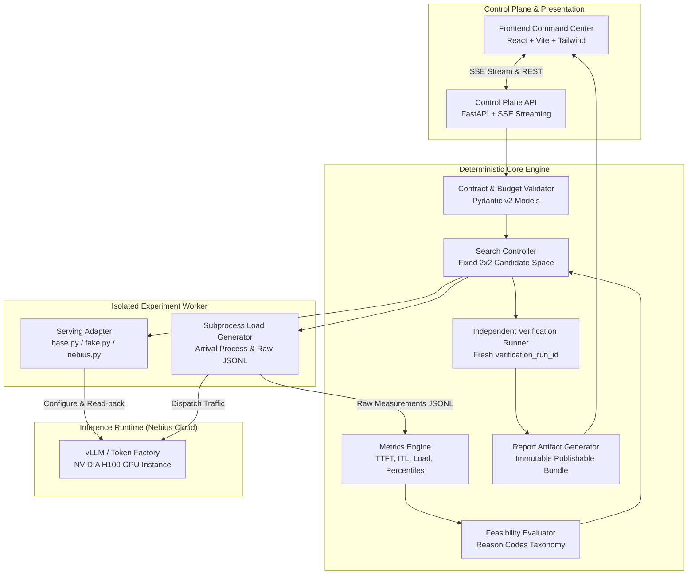
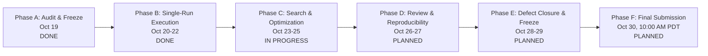

# SLOKern
### Optimize inference. Verify performance.

> **SLOKern is an SLO-aware LLM inference optimization system that measures a bounded set of serving configurations, identifies the lowest-cost configuration that satisfies a declared workload and service-level objective (SLO), and independently verifies the recommendation.**

[](LICENSE)
[](https://nebiusglobalaihackathon.devpost.com/)
[](https://nebiusglobalaihackathon.devpost.com/)
[](docs/ownership.md)

**Product Principle:** *Do not guess the optimal configuration. Find it experimentally, then verify it.*

---

## Contents

- [1. Why SLOKern?](#1-why-slokern)
- [2. Problem Statement & Core Value](#2-problem-statement--core-value)
- [3. System Architecture & Component Design](#3-system-architecture--component-design)
- [4. The 7-Step Execution Pipeline](#4-the-7-step-execution-pipeline)
- [5. Four-Domain Lifecycle & State Separation](#5-four-domain-lifecycle--state-separation)
- [6. Supported Models, Serving Path & Search Space](#6-supported-models-serving-path--search-space)
- [7. Fake-Adapter-First vs. Live Infrastructure](#7-fake-adapter-first-vs-live-infrastructure)
- [8. Cost Accounting Policy & Systems Proxy](#8-cost-accounting-policy--systems-proxy)
- [9. Current Implementation Status](#9-current-implementation-status)
- [10. Quick Start & Execution Instructions](#10-quick-start--execution-instructions)
- [11. Testing, Validation & Reproducibility](#11-testing-validation--reproducibility)
- [12. Known Limitations & Risk Management](#12-known-limitations--risk-management)
- [13. Single-Owner Roadmap (Phases A–F)](#13-single-owner-roadmap-phases-af)
- [14. Consolidated Engineering Ownership](#14-consolidated-engineering-ownership)
- [15. Related Documentation & In-Depth Guides](#15-related-documentation--in-depth-guides)

---

## 1. Why SLOKern?

In modern LLM inference serving, high throughput metrics are frequently deceptive. A serving engine configuration may deliver impressive aggregate token generation rates, yet violate critical tail-latency constraints—causing the 95th percentile Time to First Token ($\text{TTFT}_{p95}$) to spike into seconds and destroying interactive user experience. Conversely, over-provisioning GPU instances to guarantee safety margins wastes thousands of dollars in cloud spend.

Manual trial-and-error tuning is slow, noisy, and prone to false positives: a single lucky benchmark run can fool engineering teams into deploying an unstable configuration.

**SLOKern replaces guesswork with automated, deterministic systems engineering.** It accepts declared traffic profiles and non-negotiable service-level objectives, executes a bounded campaign of controlled benchmarks, deterministically eliminates infeasible candidates, selects the most cost-efficient candidate, and **independently verifies the winning configuration** under a fresh run ID before publishing recommendations.

---

## 2. Problem Statement & Core Value

SLOKern answers the fundamental systems engineering question:

> **What is the lowest-cost, verified serving configuration that reliably satisfies declared tail-latency and error-rate SLOs under a specific offered workload?**

### Core Invariants

1. **Deterministic Evaluation:** Feasibility verdicts are calculated strictly by deterministic Python code. No LLM or heuristic scorer may override hard SLO constraints or pass/fail thresholds.
2. **Missing $\ne$ Passing:** A missing or uncalculable metric returns `INCONCLUSIVE`. It can never be treated as a pass.
3. **Enforced Benchmark Budget:** The campaign allocates strictly **six runs**:
   - 1 Baseline run (default configuration).
   - 4 Candidate runs (fixed 2×2 parameter matrix).
   - 1 Independent verification rerun.
   *(Preflight smoke test is a preliminary health check counted separately. The 6-run campaign invariant is strictly enforced via preflight `validate_budget` and runtime `BudgetLimiter`; `BLK-15` resolved.)*
4. **Mandatory Independent Verification:** Independent verification is a non-negotiable core product requirement. Verification contracts and invariants are verified across 16 tests in `tests/contract/test_verification_independence.py`. Reruns use a fresh `verification_run_id` and raw evidence (`TASK-11`).
5. **Traceable Raw Evidence:** Aggregates trace to raw client request records (`RawRequestMeasurement` in JSONL). Recorded timestamps reflect arrival and token intervals.
6. **No Fabricated Pricing:** If authoritative cloud provider rates cannot be verified, monetary cost is reported as **`unavailable`**, and optimization falls back to Mode B (non-monetary systems proxy: GPU-seconds per request or throughput under SLO).

---

## 3. System Architecture & Component Design

SLOKern is architected as a **modular monolith with an isolated experiment worker**. The control plane is decoupled from the request-generation path so that API streaming, logging overhead, and UI interactions never contaminate benchmark measurements.



### Component Responsibilities

| Subsystem | Component | Implementation Path | Architectural Responsibility |
|---|---|---|---|
| **Contracts** | `Pydantic Data Models` | `src/slokern/contracts/` | Canonical schemas for specs, configurations, metrics, and verdicts (`enums.py`, `metrics.py`). |
| **Control Plane** | `FastAPI & SSE API` | `src/slokern/api/` | Accepts specifications, enforces experiment budgets, manages cancellation, streams progress. |
| **Serving** | `Serving Adapter` | `src/slokern/engine/serving/` | Intended to manage runtime lifecycle and read back effective settings. Current Nebius adapter does not apply/read back remote flags (`BLK-17`). |
| **Benchmarking** | `Subprocess Loadgen` | `src/slokern/engine/loadgen/` | Dispatches Poisson/constant arrival traffic; writes raw request timestamp observations to JSONL. Recorded precision does not establish microsecond clock accuracy. |
| **Metrics** | `Metrics Engine` | `src/slokern/core/metrics/` | Computes percentiles (p50/p95/p99), throughput, error rates; separates offered from achieved load. |
| **Evaluator** | `Feasibility Evaluator` | `src/slokern/core/evaluator/` | Audits hard constraints; emits `FEASIBLE`, `INFEASIBLE`, or `INCONCLUSIVE` with reason codes. |
| **Search** | `Search Controller` | `src/slokern/core/search/` | Current source generates the `{1024,2048} × {16,64}` grid and ranks FEASIBLE rows; budget override and missing-objective gaps remain (`BLK-15`, `BLK-16`). |
| **Verification**| `Verification Runner` | `src/slokern/core/verification/`| Intended to execute a fresh independent rerun and calculate drift; current protocol/comparison modules are stubs (`BLK-08`). |
| **Reporting** | `Report Builder` | `src/slokern/engine/reporting/` | Compiles immutable, publishable `ReportArtifact` linking all evidence, fingerprints, and limitations. |
| **Dashboard** | `Command Center` | `frontend/` | Cyberpunk-inspired technical UI displaying live monitor, candidate comparison, and audit reports. |

---

## 4. The 7-Step Execution Pipeline

SLOKern executes every experiment through a deterministic 7-step pipeline:

```text
1. Workload & SLO Specification
   Declare traffic arrival (Poisson/constant, rate, token limits) and hard constraints (TTFT p95 <= 250ms).
                ↓
2. Contract & Budget Validation
   Validate schemas and enforce candidate budget (<= 6 benchmark runs) before allocating GPU resources.
                ↓
3. Empirical Baseline Measurement
   Run default serving configuration to establish starting performance anchor and record raw JSONL traces.
                ↓
4. Bounded Candidate Search (4 runs)
   Sequentially benchmark fixed 2x2 candidate space; verify effective parameters via runtime read-back.
                ↓
5. Deterministic Feasibility Evaluation
   Calculate metrics from active measurement window; evaluate hard constraints; emit machine-readable reason codes.
                ↓
6. Objective Candidate Selection
   Filter out infeasible/inconclusive candidates; rank feasible candidates by declared efficiency objective.
                ↓
7. Independent Verification & Reporting
   Rerun winning candidate under fresh verification_run_id; compute drift; publish immutable ReportArtifact.
```

---

## 5. Four-Domain Lifecycle & State Separation

Naive benchmark harnesses collapse execution state, data quality, and SLO feasibility into a single status string. SLOKern maintains **four distinct state domains**:

```text
1. Execution Status:   PENDING → RUNNING → [ COMPLETED | FAILED | CANCELLED ]
2. Evidence Validity:  VALID | INVALID | CONTAMINATED
3. SLO Feasibility:    FEASIBLE | INFEASIBLE | INCONCLUSIVE
4. Verification State: NOT_RUN → VERIFYING → [ VERIFIED | VERIFICATION_FAILED | VERIFICATION_INCONCLUSIVE ]
```

### State Rules & Semantics

- **Execution Failed $\ne$ SLO Infeasible:** If a CUDA out-of-memory error, network abort, or bad credential causes an experiment run to crash, the run is marked `FAILED` in execution status. It is **never** recorded as an SLO breach (`INFEASIBLE`), because no valid inference distribution was observed.
- **Client Saturation $\to$ Contaminated:** If client load generator dispatch delay exceeds 10 ms or offered rate deviates by > 10%, the run is marked `generator_saturated = True`, evidence validity becomes `CONTAMINATED`, and feasibility is marked `INCONCLUSIVE` (`GENERATOR_SATURATED` / `CONTAMINATED_LOAD`). A contaminated run can never win selection.
- **Verification Independence:** Search evidence is never reused as verification. The winning candidate must independently reproduce feasibility under a new run ID.

---

## 6. Supported Models, Serving Path & Search Space

### 5-Concept Model Taxonomy

| Model Role | Model Identifier | Architecture & Specifications | Current Status |
|---|---|---|---|
| **1. Model-Agnostic Core** | Decoupled Engine | Intended separation of contracts, evaluator, load generator, and search controller. | `PARTIAL / NOT INDEPENDENTLY VERIFIED` |
| **2. Hackathon Compliance Target** | `Nemotron-3-Nano-30B-A3B` (FP8) | Official NVIDIA open-weights family: Mamba-2 hybrid layers + MoE (~30B total, ~3B active per token in design), 262K context, FP8 quantization. Listed in Nebius catalog. | `PENDING RUNTIME VERIFICATION` (Blocked on live smoke test) |
| **3. Runtime-Verified Endpoint** | *Pending Smoke Test* | Exact API model string on Nebius (e.g. `nvidia/Nemotron-3-Nano-30B-A3B`). | `PENDING RUNTIME VERIFICATION` |
| **4. Internal Pipeline Baseline** | `meta-llama/Meta-Llama-3-8B-Instruct` | Preserved from ADR 0001-A for pipeline validation, fake-adapter tests, and regression fixtures. | `COMPARATIVE ONLY` (Does not satisfy NVIDIA model mandate alone) |
| **5. Secondary Comparison Model** | `nvidia/Llama-3.1-Nemotron-70B-Instruct` | Hypothetical secondary comparison model if quota and access permit. | `UNVERIFIED` |

### Serving Infrastructure
- **Accepted model-family candidate:** Nemotron-3-Nano-30B-A3B FP8 (exact model revision and endpoint identifier remain unverified).
- **Proposed controlled path:** Nebius AI Cloud Serverless AI custom container, one H100 SXM GPU, and vLLM 0.12.0. Account capacity, quota, supported image, exact model compatibility, and effective flag read-back are unresolved; no deployment has been verified.
- **Managed reference:** Token Factory can serve as an explicitly labeled external comparison. Client request controls do not establish control over hidden server-side batching, GPU scheduling, or routing.

### Bounded Configuration Space & Architectural Notice
- **Implemented 2×2 Search Space:** Current source generates `max_num_batched_tokens ∈ {1024, 2048}` × `max_num_seqs ∈ {16, 64}`. The proposal's centre baseline `(128, 8192)` plus `{64, 256} × {2048, 16384}` is a separate, unratified five-point profile and is not implemented.
- **Workload Controls vs. Serving-Engine Controls:**
  - *Workload Parameters (`concurrency_limit`, `max_tokens`):* Regulate client load generation. Changing workload knobs does **not** prove GPU-serving optimization.
  - *Serving-Engine Parameters (`max_num_seqs`, `gpu_memory_utilization`, `kv_cache_dtype`):* Reconfigure internal serving runtime and GPU memory layout.
- **Architectural Blocker Notice:** If the live endpoint exposes only client request parameters and lacks observable/tunable serving-engine controls, this constitutes an architectural blocker. An explicit architecture decision (deploying containerized vLLM on dedicated Compute instance or refining search boundaries via ADR) will be logged.

**Profile reconciliation:** The accepted target remains the Nemotron-3-Nano-30B-A3B FP8 model family (exact checkpoint/API identifier pending). A new proposal requests a Nebius Serverless AI custom container, vLLM 0.12.0, a centre baseline `(max_num_seqs=128, max_num_batched_tokens=8192)`, and four candidates from `{64, 256} × {2048, 16384}`. This is not implemented or provider-verified. Current source still generates `{16, 64} × {1024, 2048}`, and `NebiusServingAdapter.apply_config()` does not transmit/read back vLLM flags. See [DEC-0013](docs/decision-log.md#dec-0013-reconcile-the-controlled-deployment-and-search-profile-open), [deployment notes](docs/deployment.md), and [current implementation status](docs/implementation-status.md#78-documentation-and-profile-reality-audit-2026-10-23).

---

## 7. Execution Backends & Adapter Boundary

Per **DEC-0014**, SLOKern implements three distinct execution backends sharing the identical core evaluation, load generation, metrics, verification, and reporting pipeline:

```mermaid
flowchart LR
    ExpController[Core Pipeline / CLI] --> Factory[create_serving_adapter]
    Factory -->|--adapter local (Default)| LocalAdapter[OllamaServingAdapter\nLoopback Ollama / Qwen3]
    Factory -->|--adapter fake| FakeAdapter[FakeServingAdapter\nOffline Simulator / DEMO DATA]
    Factory -->|--adapter nebius| NebiusAdapter[NebiusServingAdapter\nNebius Token Factory / Nemotron-30B]
    
    LocalAdapter --> LocalData[Real Local Observations\nHost Provenance]
    FakeAdapter --> DemoData[Synthetic Fixtures\nLabeled: DEMO DATA]
    NebiusAdapter --> LiveData[Authoritative GPU Evidence\nNebius Provenance]
```

### Backend Summary & Capabilities

1. **Local Development Backend (`local` ?" Default):**
   - **Runtime:** Native Ollama instance running locally on loopback (`http://127.0.0.1:11434`).
   - **Exact Model:** `qwen3:4b-instruct-2507-q4_K_M` over `/api/tags` and `/api/chat`.
   - **Role:** Offline local engineering velocity, request/response streaming validation, error handling, single-run execution, artifact generation, and compatible verification testing.
   - **Zero Cloud Spend:** Requires zero Nebius credentials, zero cloud credits, and zero external network access.
   - **Security Boundary:** Strictly enforces loopback addressing, prohibits HTTP 3xx redirects to prevent loopback pivoting (SSRF), rejects URL user credentials (`user:pass@host`), and disables external proxy routing.
   - **Timing Semantics:** Monotonic client clock (`time.monotonic()`) measures request-start-to-first-content latency; Ollama server-reported metadata (`prompt_eval_duration`, `eval_duration`) is preserved in milliseconds without conflation.
   - **Scope Notice:** Local mode records real host observations; it does not validate the 2x2 serving-engine optimization matrix.

2. **Deterministic Fake Backend (`fake`):**
   - **Implementation:** `FakeServingAdapter` (`src/slokern/engine/serving/fake.py`).
   - **Role:** Deterministic unit tests, failure injection (timeouts, CUDA OOM, client saturation), and reproducible synthetic campaign execution.
   - **Mandatory Guardrail:** All synthetic runs and artifacts are unmistakably labeled **`DEMO DATA`** and never presented as live GPU evidence.

3. **Live Nebius Benchmark Backend (`nebius`):**
   - **Runtime & Model:** Nebius Token Factory dedicated endpoint serving `nvidia/NVIDIA-Nemotron-3-Nano-30B-A3B` (FP8).
   - **Role:** Authoritative benchmark runs against NVIDIA GPU infrastructure.
   - **Explicit Gating:** Requires explicit operator selection (`--adapter nebius`), verified credentials (`NEBIUS_API_KEY`), and manual execution authorization. No automated cloud instance provisioning or deletion.

### Backend Selection Precedence & Zero Silent Fallback
Resolution precedence across all CLI commands and runners:
1. Explicit CLI argument: `--adapter <local|nebius|fake>`
2. Environment variable: `SLOKERN_ADAPTER`
3. Default: `"local"`

**Zero Silent Fallback:** If the selected backend cannot be initialized (e.g., `NEBIUS_API_KEY` missing when `nebius` is selected, or local Ollama is down), SLOKern halts with an immediate configuration error. It never silently substitutes another backend.

---

## 8. Cost Accounting Policy & Systems Proxy

SLOKern enforces strict cost accounting boundaries to prevent fabricated claims:

### Mode A: Trustworthy Monetary Costing
- **Precondition:** Verifiable hourly GPU instance pricing or token billing rates are officially provided (e.g., Nebius cloud rate card) and stored with explicit currency, billing increment, and time basis.
- **Formula:**
  $$\text{Cost per 1k requests} = \frac{\text{Hourly GPU Rate}}{\text{Achieved Requests per Hour}} \times 1000$$

### Mode B: Non-Monetary Systems Proxy (Active Default)
- **Precondition:** Cloud provider pricing is missing, variable, or unverified.
- **Policy:** Monetary cost is explicitly declared **`unavailable`** (never guess or fabricate prices!).
- **Objective Ranking Proxy:**
  1. *Resource-Time:* GPU seconds consumed per successful request ($\Delta t \times N_{\text{GPUs}} / N_{\text{completed}}$). *(Note: If GPU instance count and dedicated residency cannot be verified, such as on managed serverless endpoints where physical GPU allocation is hidden, GPU-seconds per request is also reported as `unavailable`, and ranking falls back to Throughput Under SLO).*
  2. *Throughput Under SLO:* Maximum achieved output tokens/second while satisfying all hard latency constraints.
- **Rule:** A non-monetary proxy must **never** be described as monetary savings or dollar amounts. Disambiguate request throughput (completed requests/s) and achieved load from hardware GPU utilization (compute/memory occupancy %).

---

## 9. Current Implementation Status

| Subsystem / Deliverable | Status | Verified Evidence & Repository Reality |
|---|---|---|
| **Data Contracts** | `IMPLEMENTED` | 11 Pydantic v2 schemas in `src/slokern/contracts/` (`extra='forbid'`, 119 contract tests pass). |
| **Subsystem Modules** | `IMPLEMENTED` | `core/` and `engine/` fully implemented with typed signatures and 322 passing tests across deterministic suites; `api/` & `cli/` deferred. |
| **Fake Serving Adapter** | `IMPLEMENTED` | `src/slokern/engine/serving/fake.py` generates deterministic synthetic runs labeled **`DEMO DATA`**. |
| **Nebius Serving Adapter** | `IMPLEMENTED (Transport)` | `src/slokern/engine/serving/nebius.py` with OpenAI-compatible urllib transport, SSE streaming, and secret sanitization; live run pending credentials (`BLK-04`). |
| **Subprocess Load Generator** | `IMPLEMENTED` | `src/slokern/engine/loadgen/runner.py` with Poisson/constant arrival, JSONL capture, and saturation detection. |
| **Deterministic Metrics Engine**| `IMPLEMENTED` | `src/slokern/core/metrics/` computes percentiles (p50/p95/p99), throughput, error rate, and offered vs achieved load. |
| **Feasibility Evaluator** | `IMPLEMENTED` | `src/slokern/core/evaluator/evaluate.py` evaluates hard constraints with NaN/negative latency guards. |
| **Single-Run Executor** | `IMPLEMENTED` | `src/slokern/engine/runner/run_executor.py` orchestrates adapter, loadgen, metrics, evaluator, and artifact persistence. |
| **2×2 Grid Search Controller** | `IMPLEMENTED` | `src/slokern/core/search/grid.py`, `budget.py`, `space.py`, `rank.py` (26 unit tests pass across search and ranker; `BLK-15` and `BLK-16` resolved). |
| **Independent Verification** | `READY / CRITICAL PATH` | Pydantic contracts locked; 16/16 contract tests pass in `test_verification_independence.py`; implementation target of Day 6. |
| **Demo Dashboard UI** | `IMPLEMENTED` | React + Vite command center in `frontend/src/App.tsx` (2553 lines, `DESIGN.md`, 9 pages, labeled **`DEMO DATA`**). |
| **Daily Delivery Roadmap** | `DOCUMENTED` | Daily execution plan (Oct 19–30, 2026) maintained in `ROADMAP.md`. |


---

## 10. Quick Start & Execution Instructions

### Prerequisites
- Python 3.11+ (virtual environment recommended).
- Local Ollama installed and running on loopback (`http://127.0.0.1:11434`) with model `qwen3:4b-instruct-2507-q4_K_M` (for local development).
- Nebius Cloud API token (`NEBIUS_API_KEY`) (strictly for gated live benchmarks; never required for local dev or tests).

### 10.1 Environment Setup

```bash
# Clone repository
git clone https://github.com/slokern/slokern.git
cd slokern

# Create and activate Python 3.11 virtual environment
python -m venv .venv
source .venv/bin/activate  # Windows: .venv\Scripts\Activate.ps1

# Install package in editable mode
pip install -e .

# Optional: Set up local Ollama model (no cloud keys needed)
ollama pull qwen3:4b-instruct-2507-q4_K_M
```

### 10.2 Local Development Commands (Ollama on Loopback)

```bash
# Preflight health check probe against local Ollama
slokern smoke-test --adapter local

# Validate an ExperimentSpec JSON file against canonical contracts
slokern validate fixtures/workloads/spec_reference.json

# Notice: 'slokern optimize --adapter local' safely halts with BLK-17 because
# Ollama does not support dynamic process-startup flag read-back per request:
slokern optimize fixtures/workloads/spec_reference.json --adapter local
# -> Halts with SearchConfigurationError (BLK-17)

# Independently verify a local single-run record
slokern verify artifacts/experiments/exp-local-01/runs/run-001/run_record.json --adapter local
```

### 10.3 Deterministic Synthetic Execution (Fake Adapter ?" DEMO DATA)

```bash
# Preflight health probe against fake adapter
slokern smoke-test --adapter fake

# Execute 6-run synthetic campaign (5 search runs + 1 independent verification run)
slokern optimize fixtures/workloads/spec_reference.json --adapter fake --output-dir artifacts/demo --auto-verify

# Compile inspectable Markdown and JSON report from experiment results
slokern report artifacts/demo/experiments/exp-test/search_result.json artifacts/demo/experiments/exp-test/runs/run-baseline/run_record.json --verification-record artifacts/demo/experiments/exp-test/verification/verif-01/verification_record.json --output artifacts/demo/report.md
```

### 10.4 Live Nebius Benchmark Execution (Gated Live Mode)

> **Authoritative Gating Notice:** Requires explicit operator selection, manual authorization, and valid `NEBIUS_API_KEY`. Live optimization halts under `BLK-17` until serving-engine parameter read-back is provisioned.

```bash
# Set Nebius credentials in environment
export NEBIUS_API_KEY="your-nebius-api-key"  # Windows: $env:NEBIUS_API_KEY="..."

# 1. Execute live endpoint preflight smoke test (1 request, health check, model probe)
slokern smoke-test --adapter nebius

# 2. Live optimization halts before allocating benchmark runs due to BLK-17:
slokern optimize fixtures/workloads/spec_reference.json --adapter nebius
# -> Halts with SearchConfigurationError (BLK-17) until dynamic flag read-back is evidenced

# 3. Independently verify an authenticated live run record
slokern verify artifacts/experiments/exp-nebius-01/runs/run-001/run_record.json --adapter nebius
```

---

## 11. Testing, Validation & Reproducibility

SLOKern enforces scientific reproducibility through strict experimental controls:

1. **Hardware & Environment Lock:** Device model, driver version, CUDA runtime, and container commit are hashed into an immutable `environment_fingerprint`.
2. **Warm-Up Isolation:** Requests initiated during the warm-up window (`warmup_duration_s`) are tagged `is_warmup = true` and strictly excluded from percentile calculations.
3. **Offered vs. Achieved Separation:** Intended arrival rate is verified against delivered completions; client thread starvation triggers `generator_saturated = True`.
4. **Deterministic Percentiles:** The helper uses linear interpolation (`percentile(..., method='linear')`) for any non-empty input. The evaluator applies `SLOSpec.min_sample_count`; it does not enforce separate p50/p95/p99 minimums or confidence intervals.
5. **Fresh Verification ID:** Rerunning the winning configuration generates a fresh `verification_run_id`; search evidence is never copied.

---

## 12. Known Limitations & Risk Management

SLOKern explicitly discloses its boundaries:

- **Bounded Search Space:** Explores a focused 2×2 configuration space. Does not claim global optimality across all possible parameters.
- **Single Serving Environment:** Optimized for single-node containerized serving on Nebius Cloud; multi-node distributed serving is out of MVP scope.
- **Non-Monetary Default:** If official cloud pricing is unavailable, monetary cost is declared `unavailable` and systems efficiency is evaluated via resource-time or throughput proxies.
- **Contingency Runbook:** If live cloud endpoints encounter connectivity interruptions during demonstrations, the dashboard falls back to pre-recorded evidence bundles (`fixtures/demo/demo_experiment.json`) with persistent **`DEMO DATA`** labeling.

---

## 13. Daily Delivery Roadmap (Phases A–F)

Execution is structured into 6 sequential phases spanning **October 19 to October 30, 2026**, targeting the hard submission deadline on **October 30, 2026, at 10:00 AM PDT (10:30 PM IST)**:



- **Phase A (Oct 19) — Audit and Scope Freeze:** `DONE`. Repository audit completed; working baseline established; core interfaces locked.
- **Phase B (Oct 20–22) — Establish Real Execution:** `DONE`. Single-run execution pipeline operational via `SingleRunExecutor` integrating Fake and Nebius adapters, subprocess load generator, metrics engine, and feasibility evaluator. React+Vite frontend command center delivered (`frontend/src/App.tsx`, 2553 lines, `DEMO DATA` labeling).
- **Phase C (Oct 23–25) — Validate Optimization:** `IN PROGRESS`. Bounded 2×2 grid search controller (`grid.py`), `SearchSpace`, `BudgetLimiter`, and `CandidateRanker` implemented with 26 unit tests (`TASK-10`). Independent verification runner (`TASK-11`) ready for Day 6 implementation with 16 contract tests verified in `test_verification_independence.py` (16 contract tests verified in `test_verification_independence.py`).
- **Phase D (Oct 26–27) — Independent Review & Reproducibility:** Execute independent verification rerun under fresh run ID; audit metric drift; complete test suites; compile report artifact.
- **Phase E (Oct 28–29) — Defect Closure & Freeze:** Feature freeze; close critical defects; automated test suite validation; clean clone installation check; record demo video ($\le 3$ minutes).
- **Phase F (Oct 30) — Submit:** Final repository audit; Devpost submission completed before 10:00 AM PDT (10:30 PM IST) with 4-hour buffer.

See **[ROADMAP.md](ROADMAP.md)** for complete daily task descriptions, deliverables, and acceptance gates.


---

## 14. Subsystem Ownership & Execution Model

SLOKern operates under a **Strict Solo-Development and Solo-Execution Model**:

- **Rajdeep:** Sole technical owner, sole implementation owner, sole testing and verification owner, sole benchmarking and measurement owner, sole architecture and decision authority, sole integration and release authority, and sole documentation and hackathon submission owner.
- **Execution Model:** Independent solo execution, with no active collaborator workstreams.

Former contributors (Aman on serving, Rohan on search, Adriraj on benchmarking exploration, Daksh on boundary test exploration) contributed early design work in Phase 1 and Phase 2. They are not participating in current execution, and no ongoing tasks, gates, reviews, or deliverables are assigned to them. Rajdeep independently executes and verifies the complete minimum viable product.

| Area / Subsystem | Accountable Owner | Status | Historical Attribution |
|---|---|---|---|
| **Architecture & Technical Direction** | **Rajdeep** | ACTIVE (SOLO) | Rajdeep |
| **Serving & Infrastructure** | **Rajdeep** | ACTIVE (SOLO) | Aman |
| **Loadgen Subprocess & Workload** | **Rajdeep** | ACTIVE (SOLO) | Adriraj |
| **Evaluator Core & Verification Runner** | **Rajdeep** | ACTIVE (SOLO) | Daksh |
| **Optimizer & Search Controller** | **Rajdeep** | ACTIVE (SOLO) | Rohan |
| **CI, API & End-to-End Integration** | **Rajdeep** | ACTIVE (SOLO) | Cross-team |
| **Documentation, Demo & Submission** | **Rajdeep** | ACTIVE (SOLO) | Rajdeep |
| **Benchmark Integrity & Credibility** | **Rajdeep** | ACTIVE (SOLO) | Adriraj |
| **Independent Decision Verification** | **Rajdeep** | ACTIVE (SOLO) | Daksh |

For the complete responsibility matrix, governance model, and daily rituals, see **[docs/ownership.md](docs/ownership.md)**.

---

## 15. Related Documentation & In-Depth Guides

- [Architecture & Contract Specification](docs/architecture.md)
- [Single-Owner Execution & Responsibility Matrix](docs/ownership.md)
- [Architecture Decision Log](docs/decision-log.md)
- [MVP Scope & Acceptance Checklist](docs/mvp-checklist.md)
- [Daily Integration Checklist & Protocol](docs/integration-checklist.md)
- [Decision Policy & Feasibility Semantics](docs/decision-policy.md)
- [Metrics Definitions & Aggregation Rules](docs/metrics.md)
- [Experiment & Measurement Methodology](docs/experiment-methodology.md)
- [Serving Deployment & Operational Guide](docs/deployment.md)
- [Demo Presentation Script & Runbook](docs/demo-script.md)
- [Official Hackathon Compliance & Requirements Matrix](docs/hackathon-compliance.md)
- [Project Flow & Mental Model Guide](docs/project-flow-and-mental-model.md)
- [Nebius & NVIDIA Tool Feedback Register](docs/hackathon-feedback.md)

---

## Final Operating Principle

Build the smallest complete system that can **measure, decide, verify, and explain**.

SLOKern is intended to support recommendations from controlled measurements, deterministic rules, a declared objective, and an independent verification run. The current implementation still has active search, serving-control, and verification gaps documented above; any live recommendation must wait for those gaps to close.

**Optimize inference. Verify performance.**
