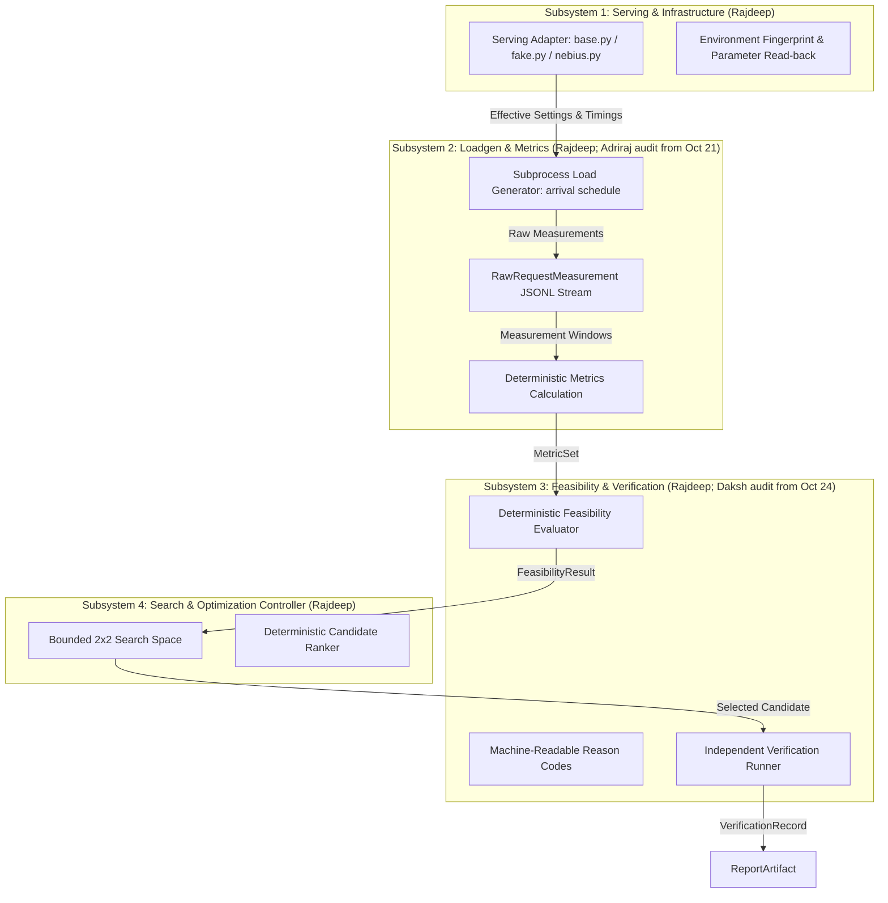
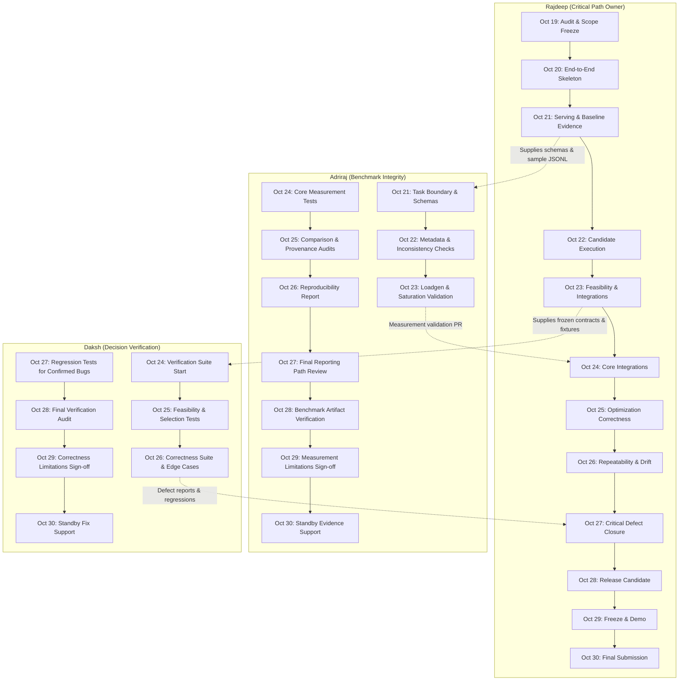
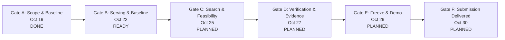

# SLOKern — Execution Roadmap
### Daily delivery plan, ownership restructure, dependency graph, acceptance gates, and submission readiness

> **Mission:** Deliver a defensible end-to-end SLO-aware inference optimizer—not merely a polished dashboard—by proving that a bounded search can measure candidates, apply deterministic SLO rules, select a candidate, and independently verify it.

**Planning baseline:** October 19, 2026  
**Execution window:** October 19–30, 2026  
**Submission-day buffer:** October 30, 2026  
**Hard submission deadline:** **Friday, October 30, 2026, at 10:00 AM PDT (10:30 PM IST)**  
**Sole accountable technical owner:** Rajdeep (Architecture, Optimizer, Serving, Loadgen, Evaluator, CI/Validation, Documentation/Submission)  
**Collaborator execution:**  
- **Adriraj:** Benchmark integrity & measurement credibility (active execution begins **October 21, 2026**)  
- **Daksh:** Independent decision verification (active execution begins **October 24, 2026**)  
**Historical team context:** Project originally conceptualized by a 5-person team (Rajdeep, Aman, Daksh, Adriraj, Rohan). Effective October 18–19, 2026, engineering execution is restructured under Rajdeep as sole technical lead, with bounded collaborator workstreams for Adriraj (from Oct 21) and Daksh (from Oct 24). Aman and Rohan are acknowledged as historical design contributors with no ongoing tasks assigned.

> [!IMPORTANT]
> The submission deadline is **October 30, 2026, at 10:00 AM PDT (equivalent to 10:30 PM IST)**. All sprint planning and milestone gates are anchored to this hard cutoff.
>
> This roadmap reflects **single-owner core execution with bounded collaborators** and distinguishes **completed work**, **implemented but unverified work**, **in-progress work**, and **planned work**. No benchmark result, integration, or capability is claimed as complete without physical repository evidence.
>
> At the start of each day, update task statuses (`TODO`, `IN PROGRESS`, `BLOCKED`, `DONE`) with a commit, test output, or artifact reference.

---

## Contents

1. [Operating rules](#1-operating-rules)
2. [Subsystem ownership model and preserved boundaries](#2-subsystem-ownership-model-and-preserved-boundaries)
3. [Critical path and dependency graph](#3-critical-path-and-dependency-graph)
4. [Phase map (October 19–30, 2026)](#4-phase-map-october-1930-2026)
5. [Daily delivery roadmap: October 19–30, 2026](#5-daily-delivery-roadmap-october-1930-2026)
6. [Daily reporting and acceptance ritual](#6-daily-reporting-and-acceptance-ritual)
7. [Shared contracts and subsystem interfaces](#7-shared-contracts-and-subsystem-interfaces)
8. [Acceptance gates](#8-acceptance-gates)
9. [Experiment protocol and budget invariants](#9-experiment-protocol-and-budget-invariants)
10. [Testing matrix](#10-testing-matrix)
11. [Demo and submission plan](#11-demo-and-submission-plan)
12. [Risk register and contingency decisions](#12-risk-register-and-contingency-decisions)
13. [Definition of done](#13-definition-of-done)
14. [Daily execution log template](#14-daily-execution-log-template)

---

## 1. Operating rules

### 1.1 The product promise is the scope boundary

SLOKern accepts a declared workload and SLO specification, measures a bounded set of legal serving configurations, identifies the lowest-cost evidenced feasible candidate under a declared objective, and independently verifies it—or reports honestly that no tested configuration was proven feasible.

The core promise requires:

1. one supported model (`Nemotron-3-Nano-30B-A3B` FP8 as hackathon target candidate; `meta-llama/Meta-Llama-3-8B-Instruct` as comparative baseline);
2. one serving environment (Nebius AI Cloud / Token Factory);
3. one reproducible workload fixture;
4. a bounded configuration space (fixed 2×2 parameter matrix; 4 candidates total);
5. unaggregated raw measurement event logs (`RawRequestMeasurement` in JSONL);
6. deterministic feasibility evaluation and machine-readable reason codes;
7. bounded candidate search, ranker, and selection rationale;
8. an independent verification rerun under a fresh `verification_run_id`;
9. a self-contained report artifact that makes the result inspectable.

Everything else is secondary until this end-to-end chain executes cleanly.

### 1.2 Work in dependency order

The execution order is strictly enforced:

$$\text{Serving smoke test} \to \text{Valid single-run measurement} \to \text{Deterministic evaluator} \to \text{Empirical baseline} \to \text{Bounded search (4 candidates)} \to \text{Selection} \to \text{Independent verification} \to \text{Dashboard/report integration} \to \text{Polished demo}$$

The fake-adapter-first workflow allows developing and verifying the evaluator, metrics calculations, ranker, and dashboard offline using synthetic fixtures. However, all synthetic data must remain explicitly labeled **`DEMO DATA`** and must not delay the real serving path.

### 1.3 No unsupported claims

- Do not invent benchmark numbers or latency improvements.
- Do not call synthetic fixtures or mock runs “live results.”
- Do not claim dollar savings without an authoritative cloud pricing source; default to Mode B (non-monetary systems proxy) and report monetary cost as `unavailable`.
- Do not award a candidate the `VERIFIED` status until an independent rerun under a fresh `verification_run_id` succeeds.
- Do not claim global optimality—report the best verified candidate within the declared 2×2 search space.
- Do not expose a tuning control unless the serving adapter can apply and confirm it via runtime read-back.
- Never hide failed candidates or contaminated runs.

### 1.4 Definition of a task being done

A task is `DONE` only when the deliverable exists, executes or validates, and is backed by physical evidence. “Code written” is not sufficient.

Acceptable evidence includes:
- a committed file or passing test command output;
- a schema-validated artifact on disk;
- a captured live log or environment fingerprint;
- a documented blocker and recorded decision in [docs/decision-log.md](docs/decision-log.md).

---

## 2. Subsystem ownership model and preserved boundaries

### 2.1 Subsystem ownership matrix

The ownership structure follows a **single-owner core with bounded collaborator contributions**:

| Functional Area | Accountable Owner | Active Window | Scope and Module Mapping |
|---|---|---|---|
| **Architecture & Technical Direction** | **Rajdeep** | Full sprint | Scope boundaries, modular monolith design, Pydantic v2 contracts (`src/slokern/contracts/`), enums, state machine, and interface stability. |
| **Serving & Infrastructure** | **Rajdeep** *(Hist: Aman)* | Full sprint | Nebius serving adapter (`src/slokern/engine/serving/nebius.py`), fake adapter (`fake.py`), preflight smoke testing, runtime fingerprinting, parameter read-back. |
| **Loadgen Subprocess & Workload** | **Rajdeep** *(Hist: Adriraj)* | Full sprint | Workload fixtures (`fixtures/workloads/`), subprocess load generator (`src/slokern/engine/loadgen/`), raw event capture to JSONL (`RawRequestMeasurement`), saturation detection. |
| **Evaluator Core & Feasibility Policy** | **Rajdeep** *(Hist: Daksh)* | Full sprint | Deterministic evaluator engine (`src/slokern/core/evaluator/`), reason code taxonomy (`enums.py`), hard constraint audits, audit notes. |
| **Optimizer & Search Controller** | **Rajdeep** *(Hist: Rohan)* | Full sprint | Bounded 2×2 parameter matrix definition, stable candidate hashing, candidate ranking under declared objective (`src/slokern/core/search/`), 6-run budget enforcement. |
| **Verification Runner** | **Rajdeep** *(Hist: Daksh)* | Full sprint | Independent verification rerun orchestration under fresh `verification_run_id` (`src/slokern/core/verification/`), metric drift computation ($\Delta M$). |
| **Control Plane, CLI & Storage** | **Rajdeep** | Full sprint | FastAPI app (`src/slokern/api/`), SSE streaming, CLI (`src/slokern/cli/`), artifact store layout (`src/slokern/engine/store/`), secret redaction. |
| **Reporting, Presentation & Submission** | **Rajdeep** | Full sprint | Report generator (`src/slokern/engine/reporting/`), frontend command center (`frontend/`, labeled **`DEMO DATA`** offline), demo script/video, Devpost submission. |
| **Benchmark Integrity & Credibility** | **Adriraj** | **Oct 21–30** | Benchmark schema validation, required metadata checks, missing/inconsistent record detection, offered-vs-achieved load audits, comparison summaries, failed-run test fixtures, measurement limitations documentation (`docs/metrics.md`). |
| **Independent Decision Verification** | **Daksh** | **Oct 24–30** | Independent verification test suite, hard SLO violation tests, feasibility boundary tests, missing/invalid measurement handling, failed experiment tests, candidate selection verification under documented objective semantics, reproducible defect reports (`docs/decision-policy.md`). |

*Historical context:* Aman (serving infrastructure) and Rohan (search space & ranking) contributed early design work in Phase 1 (Oct 13–17, 2026). They are not active in the current sprint; no ongoing work is assigned to them.

### 2.2 Preserved subsystem boundaries

Consolidating technical leadership under Rajdeep preserves the 4 architectural subsystem boundaries:



- **Boundary 1 (Serving):** Only parameters confirmed supported via runtime read-back enter the candidate search space.
- **Boundary 2 (Loadgen/Metrics):** Raw event logs are preserved; client saturation flags run contamination (`generator_saturated`).
- **Boundary 3 (Evaluator/Verification):** Evaluator code owns verdicts; missing metric $\ne$ pass; search evidence is never reused as verification.
- **Boundary 4 (Search/Optimizer):** Operates strictly within the 6-run budget (1 baseline + 4 candidates + 1 verification rerun).

---

## 3. Critical path and dependency graph

The conceptual sequence is:

$$\text{Workload \& Config} \to \text{Candidate Generation} \to \text{Serving Execution} \to \text{Measurement Capture} \to \text{Result Validation} \to \text{Feasibility \& Optimization} \to \text{Recommendation \& Report}$$

### Inter-Contributor Dependencies



### Stop-the-line escalation conditions

Stop work and resolve immediately if:
1. Target model (`Nemotron-3-Nano-30B-A3B` FP8) is unreachable or lacks accessible endpoint on Nebius during live smoke test.
2. The serving interface exposes only client request parameters and lacks tunable serving-engine knobs (architectural blocker requiring immediate ADR decision).
3. The load generator cannot maintain the offered schedule and flags `generator_saturated = True`.
4. Monetary cloud rates are unverified while dollar savings claims appear in reports (enforce Mode B immediately).
5. Verification rerun fails or cannot be executed independently under a fresh `verification_run_id`.
6. Dashboard development delays the real inference measurement path.

---

## 4. Phase map (October 19–30, 2026)

| Phase | Dates | Focus | Target Deliverables & Exit Conditions | Status |
|---|---|---|---|---|
| **Phase A** | **Oct 19** | **Audit and scope freeze** | Audit contracts, freeze MVP scope, establish hybrid solo-core execution baseline, verify fake adapter. | `DONE / VERIFIED` |
| **Phase B** | **Oct 20–22** | **Establish real execution** | Complete Nebius serving adapter, execute live smoke test, confirm model string, capture baseline evidence. Adriraj begins benchmark integrity Oct 21. | `PLANNED / READY` |
| **Phase C** | **Oct 23–25** | **Validate optimization** | Execute bounded 2×2 candidate search (4 runs) + baseline, record metrics, evaluate hard SLO feasibility, rank candidates. Daksh begins independent verification Oct 24. | `PLANNED` |
| **Phase D** | **Oct 26–27** | **Independent review and reproducibility** | Launch fresh verification rerun under new run ID, audit drift, complete correctness and measurement suites, resolve defects. | `PLANNED` |
| **Phase E** | **Oct 28–29** | **Freeze and prepare** | Freeze code, run full automated test suite, verify clean clone installation, record demo video, test fallback runbook. | `PLANNED` |
| **Phase F** | **Oct 30** | **Submit** | Verify Devpost requirements, record submission artifacts, submit before 10:00 AM PDT (10:30 PM IST). | `PLANNED` |

---

## 5. Daily delivery roadmap: October 19–30, 2026

### October 19: Audit and scope freeze

- **Owner:** **Rajdeep**
- **Concrete Engineering Objective:** Complete comprehensive repository and implementation audit; establish working baseline; confirm subsystem boundaries and Pydantic v2 contracts; freeze MVP scope; identify highest-risk architectural blockers.
- **Expected Deliverable:** Verified status matrix, single-owner ownership matrix (`docs/ownership.md`), and dependency-aware roadmap (`ROADMAP.md`).
- **Acceptance Criteria:** Every critical subsystem has a named directly accountable owner, a verified status, and a testable next step. Zero unverified completion claims.
- **Dependencies or Blockers:** Clean repository working tree.
- **Fallback:** Prioritize critical-path modules; mark unverified components as `PENDING RUNTIME VERIFICATION`.

---

### October 20: Establish the end-to-end skeleton

- **Owner:** **Rajdeep**
- **Concrete Engineering Objective:** Verify the end-to-end execution path from workload declaration (`WorkloadSpec`) through candidate evaluation and reporting; confirm serving adapter and benchmark interfaces; resolve schema/contract mismatches without architectural churn; ensure deterministic development tests execute cleanly on the fake adapter without GPU dependency.
- **Expected Deliverable:** Runnable, testable development path executing end-to-end with documented limitations; passing contract test suite (`pytest tests/contract`).
- **Acceptance Criteria:** The pipeline executes its supported stages end-to-end using the fake adapter; reports missing or unsupported stages honestly; all synthetic output is labeled **`DEMO DATA`**.
- **Dependencies or Blockers:** Fake serving adapter operational (`src/slokern/engine/serving/fake.py`); Pydantic v2 schemas locked.
- **Fallback:** If a downstream stage has broken interfaces, isolate it with an explicit error boundary, stub with typed contracts, and log in `docs/decision-log.md`.

---

### October 21: Serving and baseline evidence

- **Active Contributors:** **Rajdeep** (Critical Path) & **Adriraj** (Benchmark Integrity Start)
- **Rajdeep Objective:** Establish and validate real serving execution against the Nebius endpoint; execute 1-request preflight smoke test (`scripts/smoke.py`); capture environment fingerprint; capture an initial reproducible baseline measurement (Run 1 of 6); supply existing result schemas, representative records, and interface notes to Adriraj.
- **Adriraj Objective:** Inspect existing benchmark schema (`src/slokern/contracts/metrics.py`) and result pipeline; confirm task boundaries and acceptance criteria; begin implementing result validation and benchmark-integrity checks; record schema ambiguities rather than changing contracts.
- **Expected Deliverable:** Baseline evidence on disk (`artifacts/experiments/<baseline-id>/measurements.jsonl`) or an explicit infrastructure-blocker report; plus Adriraj's initial validation plan and test fixtures.
- **Acceptance Criteria:** Baseline raw request measurements are captured with microsecond timestamps; no synthetic result is represented as a live benchmark; Adriraj confirms task boundaries.
- **Dependencies or Blockers:** Nebius API token, active instance, and model availability (for Rajdeep); schema and sample records provided by Rajdeep (for Adriraj).
- **Fallback (Rajdeep):** If Nebius infrastructure is inaccessible, capture baseline using fake adapter with persistent **`DEMO DATA`** label, log blocker in `docs/decision-log.md`, and proceed with offline pipeline integration.
- **Fallback (Adriraj):** Work against existing golden metric fixtures (`fixtures/metrics_golden/`) and sample JSONL files.

---

### October 22: Measurement pipeline and initial candidate execution

- **Active Contributors:** **Rajdeep** & **Adriraj**
- **Rajdeep Objective:** Validate baseline measurements; execute the initial bounded candidate set (Runs 2 and 3 of 6) where infrastructure permits; resolve serving or result-capture defects; confirm that measurements can be consumed by the existing optimizer.
- **Adriraj Objective:** Implement initial measurement and metadata validation; test handling of missing metrics, invalid records, and failed runs; produce first reproducible candidate-comparison report from supplied data.
- **Expected Deliverable:** Validated benchmark records on disk or documented blockers; executable measurement analysis workflow from Adriraj.
- **Acceptance Criteria:** Invalid or incomplete records cannot silently appear as successful measurements; candidate metrics are calculated deterministically.
- **Dependencies or Blockers:** Baseline measurement stream available (or synthetic fixtures if live access is delayed).
- **Fallback:** Execute candidate configurations against fake adapter; preserve live execution blocker notes in sprint log.

---

### October 23: Candidate feasibility and integration

- **Active Contributors:** **Rajdeep** & **Adriraj**
- **Rajdeep Objective:** Verify candidate feasibility and optimizer integration; complete candidate benchmark runs (Runs 4 and 5 of 6); check hard SLO constraint enforcement; confirm that infeasible candidates cannot win through an invalid scoring path; prepare stable contracts and test fixtures for Daksh's October 24 start.
- **Adriraj Objective:** Complete first working measurement-validation module; validate offered-versus-achieved load reporting where underlying data supports it; add regression tests for discovered data-integrity issues.
- **Expected Deliverable:** Coherent candidate-evaluation path; initial reviewable Adriraj pull request with measurement integrity tests; stable test fixtures packaged for Daksh.
- **Acceptance Criteria:** Candidate can be evaluated using documented evidence and existing feasibility semantics; hard constraint failure produces `INFEASIBLE` with correct reason code; Daksh receives verified fixture bundle.
- **Dependencies or Blockers:** Candidate benchmark records and evaluator module stability.
- **Fallback:** Use hand-calculated golden fixtures (`fixtures/metrics_golden/`) to test feasibility evaluation logic.

---

### October 24: Verification begins

- **Active Contributors:** **Rajdeep**, **Daksh** (Independent Verification Start), **Adriraj**
- **Rajdeep Objective:** Integrate completed benchmark-analysis work from Adriraj where safe; run end-to-end tests; fix critical correctness or integration defects; onboard Daksh with stable contracts and test fixtures.
- **Daksh Objective:** Begin independent verification; implement test suite for hard SLO violations and feasibility boundaries; cover missing measurements and failed experiments; report ambiguous expected behavior to Rajdeep instead of inventing semantics.
- **Adriraj Objective:** Address review findings on measurement validation; complete core measurement-integrity tests; document known measurement limitations.
- **Expected Deliverable:** First verification test suite from Daksh; reviewable measurement-validation implementation from Adriraj; integrated end-to-end pipeline.
- **Acceptance Criteria:** Each contribution runs independently against established contracts (`src/slokern/contracts/`); Daksh's test suite detects deliberate threshold breaches; Adriraj's validator flags malformed records.
- **Dependencies or Blockers:** Stable contracts and test fixtures delivered to Daksh by Rajdeep.
- **Fallback:** Daksh works strictly against committed Pydantic contracts and synthetic edge-case fixtures.

---

### October 25: Optimization correctness and benchmark integrity

- **Active Contributors:** **Rajdeep**, **Daksh**, **Adriraj**
- **Rajdeep Objective:** Validate candidate ranking and objective semantics (Mode A cost vs. Mode B systems proxy); verify recommendations match actual measured evidence; run a bounded end-to-end experiment; resolve critical integration issues.
- **Daksh Objective:** Test candidate selection and infeasible-candidate rejection; test invalid configurations and relevant boundary cases; provide reproducible failure reports.
- **Adriraj Objective:** Validate comparison reports and metadata consistency; test incomplete and failed benchmark records; ensure reported metrics are derived from supplied measurements rather than hardcoded values.
- **Expected Deliverable:** Comprehensive correctness and measurement test coverage; reproducible failure reports (if any bugs are uncovered).
- **Acceptance Criteria:** No known critical failure is silently treated as a valid result; candidate selection rejects infeasible candidates deterministically; winner matches lowest-cost feasible criteria.
- **Dependencies or Blockers:** Candidate evaluation and search results generated.
- **Fallback:** Focus testing on unit and contract test levels with parameterized pytest fixtures.

---

### October 26: Independent review and reproducibility

- **Active Contributors:** **Rajdeep**, **Daksh**, **Adriraj**
- **Rajdeep Objective:** Execute independent verification rerun (Run 6 of 6) of selected winning candidate under fresh `verification_run_id`; compare repeated measurements using existing methodology; investigate unstable results and runtime failures; prioritize defects by effect on recommendation.
- **Daksh Objective:** Complete main decision-correctness suite; validate rejection behavior and edge cases; report coverage and unresolved defects.
- **Adriraj Objective:** Complete reproducibility and result-integrity report; verify experiment metadata and comparison summaries are consistent.
- **Expected Deliverable:** Repeatable evidence bundle (`VerificationRecord`); documented correctness and reproducibility status.
- **Acceptance Criteria:** Differences between repeated runs ($\Delta M$) are computed and reported honestly; no claim of determinism for inherently variable measurements; independent verification verdict rendered (`VERIFIED` or failed).
- **Dependencies or Blockers:** Live endpoint access for rerun (or verified fake rerun if offline).
- **Fallback:** Document measurement variance explicitly; report metric ranges if live runs show network or GPU jitter.

---

### October 27: Critical defect closure

- **Active Contributors:** **Rajdeep**, **Daksh**, **Adriraj**
- **Rajdeep Objective:** Fix critical defects in core execution path identified by Daksh and Adriraj; integrate accepted verification and benchmark changes; re-run all affected tests; freeze unnecessary scope expansion.
- **Daksh Objective:** Add regression tests for confirmed defects; verify that documented expectations match contracts.
- **Adriraj Objective:** Address critical review findings; validate final result-reporting path.
- **Expected Deliverable:** Release-candidate functionality with no known unaddressed critical defects; passing regression test suite.
- **Acceptance Criteria:** Core execution path is fully testable; remaining limitations are explicitly documented in `README.md` and `docs/mvp-checklist.md`.
- **Dependencies or Blockers:** Defect reports from Daksh and Adriraj delivered by midday.
- **Fallback:** If a non-critical defect cannot be cleanly resolved, document it explicitly under Known Limitations and configure evaluator to fail closed.

---

### October 28: Release candidate and demonstration

- **Active Contributors:** **Rajdeep**, **Daksh**, **Adriraj**
- **Rajdeep Objective:** Run complete available test suite; verify setup and execution instructions from clean clone; validate demonstration script using real evidence where required; prepare fallback for infrastructure failures without misrepresenting mock output.
- **Daksh Objective:** Execute final verification suite; report remaining correctness issues and test outcomes.
- **Adriraj Objective:** Regenerate benchmark report from preserved records; confirm result summaries are reproducible from supplied data.
- **Expected Deliverable:** Release candidate tag; validated evidence bundle; rehearsed demonstration script and fallback runbook.
- **Acceptance Criteria:** A clean execution path exists for the supported MVP; demo runs cleanly in $\le 3$ minutes; fallback mode displays persistent **`DEMO DATA`** labels.
- **Dependencies or Blockers:** Stable codebase and evidence artifacts.
- **Fallback:** Verify demo fallback runbook using pre-recorded evidence bundle (`fixtures/demo/demo_experiment.json`).

---

### October 29: Feature freeze and submission preparation

- **Active Contributors:** **Rajdeep**, **Daksh**, **Adriraj**
- **Rajdeep Objective:** Enforce absolute feature freeze; resolve only critical correctness, reliability, and submission issues; review README, architecture description, limitations, and roadmap; validate final submission narrative against actual implementation; record and edit $\le 3\text{-minute}$ walkthrough video.
- **Daksh Objective:** Confirm final verification status; document any remaining known correctness limitations.
- **Adriraj Objective:** Confirm final benchmark evidence and reproducibility status; document infrastructure and measurement limitations.
- **Expected Deliverable:** Submission-ready repository; published demo video link; completed submission text draft.
- **Acceptance Criteria:** No unsupported claims, unreviewed critical changes, or undocumented known blockers; video uploaded and playable.
- **Dependencies or Blockers:** All core unit and contract tests passing; video recording tools ready.
- **Fallback:** Record demo using verified local artifacts if live endpoint encounters connectivity interruptions.

---

### October 30: Submission day

- **Active Contributors:** **Rajdeep** (Sole Submission Authority); **Daksh** & **Adriraj** on standby.
- **Rajdeep Objective:** Verify repository status and required artifacts; confirm registration and submission requirements; run final smoke tests; complete Devpost filing with tool feedback; submit with sufficient time buffer before **October 30, 2026, 10:00 AM PDT (10:30 PM IST)**; preserve final submitted commit reference.
- **Daksh:** Remain available for a narrowly scoped verification fix if needed.
- **Adriraj:** Remain available for a narrowly scoped evidence or reporting correction if needed.
- **Expected Deliverable:** Completed, confirmed Devpost submission; archived submission receipt and commit hash.
- **Acceptance Criteria:** Submission confirmed before deadline. **No new features scheduled or merged on submission day.**
- **Dependencies or Blockers:** Complete Devpost text draft, verified video link, and clean repository revision on `main`.
- **Fallback:** If late-breaking polish encounters any friction, freeze immediately and submit with the existing release-candidate commit and validated offline evidence bundle to protect the deadline buffer.
- **Buffer:** Complete submission by 18:00 IST (4.5 hours before the 10:30 PM IST deadline).

---

## 6. Daily reporting and acceptance ritual

To maintain high velocity and zero coordination waste:

### Contributor Daily Report (Submitted by 18:30 IST)
1. **What was completed today:** Exact deliverables and PRs.
2. **Which files changed:** List of modified paths.
3. **Validation commands executed:** Exact commands run (`pytest`, `slokern`, etc.).
4. **Actual outcomes:** Passed, failed, skipped, or blocked.
5. **Outstanding blockers:** Specific external dependencies or interface ambiguities.
6. **Next concrete deliverable:** Specific target for tomorrow.

### Rajdeep's Daily Integration Decision
- Rajdeep reviews the critical path daily and makes explicit decisions to **continue**, **reassign**, **reduce**, or **cut** work.
- If a collaborator misses an acceptance criterion, Rajdeep assesses whether the task was adequately specified, whether an external blocker exists, and either narrows, reassigns, or completes the critical portion directly.
- Tasks are never marked complete merely because their planned calendar date passed.

---

## 7. Shared contracts and subsystem interfaces

All communication between subsystems is mediated by Pydantic v2 models in `src/slokern/contracts/`:

1. **`WorkloadSpec`:** Traffic profile, arrival mode (Poisson/constant), offered rate, duration, token bounds.
2. **`SLOSpec`:** Non-negotiable latency (TTFT, ITL), throughput, and error rate thresholds.
3. **`CandidateConfig`:** Requested settings vs. effective read-back settings and environment fingerprint.
4. **`ExperimentSpec`:** Root document bundling workload, SLO, search space, and 6-run budget.
5. **`RunRecord`:** Single execution run metadata, execution status, and artifact paths.
6. **`RawRequestMeasurement`:** Granular unaggregated request event capture (written to JSONL).
7. **`MetricSet`:** Aggregated performance indicators derived deterministically; offered vs. achieved load.
8. **`FeasibilityResult`:** Constraint-by-constraint audit, reason codes, and overall verdict.
9. **`SearchResult`:** Bounded exploration history, candidate rankings, and stopping rationale.
10. **`VerificationRecord`:** Independent verification run audit, metric comparison, drift, and final verdict.
11. **`ReportArtifact`:** Self-contained immutable bundle linking recommendation, evidence, and limitations.

---

## 8. Acceptance gates

Advancement is governed by evidence on disk:



- **Gate A — Scope & Baseline Stabilized (End of Oct 19):**
  - [x] Ownership restructured under Rajdeep; Adriraj (Oct 21) and Daksh (Oct 24) bounded workstreams defined.
  - [x] Core contracts (`enums.py`, `metrics.py`) locked; subsystem boundaries preserved.
  - [x] Deterministic fake adapter verified for offline development.
  - [x] Documentation suite updated and internally consistent.

- **Gate B — Serving Path & Baseline Measured (End of Oct 22):**
  - [ ] Live Nebius endpoint reachable via serving adapter (`scripts/smoke.py`).
  - [ ] `smoke_test_result.json` saved with confirmed model ID.
  - [ ] Serving-engine parameter read-back confirmed or architectural fallback logged.
  - [ ] Baseline run executed; raw JSONL stream and metrics captured.
  - [ ] Adriraj's initial measurement validation suite running.

- **Gate C — Bounded Optimization Validated (End of Oct 25):**
  - [ ] Bounded 2×2 search space executed (4 candidate runs).
  - [ ] 6-run benchmark budget strictly respected.
  - [ ] Feasibility evaluator emits deterministic verdicts and reason codes.
  - [ ] Lowest-cost feasible candidate selected under declared objective.
  - [ ] Daksh's independent decision-verification suite running.

- **Gate D — Independent Evidence Reviewed (End of Oct 27):**
  - [ ] Independent verification rerun executed under fresh `verification_run_id`.
  - [ ] Drift analysis computed; final verdict rendered (`VERIFIED` or failed).
  - [ ] Error-handling and OOM protection validated.
  - [ ] Complete `ReportArtifact` compiled with raw evidence links.
  - [ ] Critical defects closed with regression tests.

- **Gate E — Release Candidate & Demo Frozen (End of Oct 29):**
  - [ ] Feature freeze enforced; automated tests pass.
  - [ ] Setup verified from clean clone (`pip install -e .`).
  - [ ] $\le 3\text{-minute}$ demo video recorded and uploaded.
  - [ ] Demo fallback runbook verified with **`DEMO DATA`** labels.

- **Gate F — Final Submission Delivered (Oct 30):**
  - [ ] Public GitHub repository validated (no secrets, Apache 2.0 license).
  - [ ] Devpost submission completed with video, repo, and mandatory tool feedback.
  - [ ] Submission confirmed prior to 10:00 AM PDT (10:30 PM IST).

---

## 9. Experiment protocol and budget invariants

### Budget Invariant: Six Benchmark Runs
1. **Run 1:** Baseline measurement (default serving configuration).
2. **Runs 2–5:** Bounded candidate search (fixed 2×2 parameter matrix, 4 candidates).
3. **Run 6:** Independent verification rerun of the selected winning candidate.
*(The preflight smoke test is a preliminary health check counted separately).*

### Dual-Mode Cost Policy
- **Mode A (Monetary Cost):** Applied only when authoritative cloud provider rates are officially provided and stored with currency, billing increment, and time basis.
- **Mode B (Systems Proxy, Active Default):** Monetary cost is explicitly declared **`unavailable`** (never guess prices). Optimization ranks by GPU-seconds per request or throughput under SLO.

---

## 10. Testing matrix

| Test Area | Subsystem Boundary | Required Test Cases | Accountable Owner | Status |
|---|---|---|---|---|
| **Schema & Contracts** | Architecture | Valid spec, invalid spec, missing required fields, enum validation | Rajdeep | `IMPLEMENTED` |
| **Serving Adapter** | Serving | Healthy smoke request, timeout, unavailable endpoint, apply/read-back, OOM handling | Rajdeep | `IN PROGRESS` |
| **Loadgen Subprocess** | Benchmarking | Arrival schedule timing, generator saturation skew, error handling, JSONL write | Rajdeep | `IN PROGRESS` |
| **Metrics Calculation** | Benchmarking | Percentiles (p50/p95/p99), zero samples, error rate denominator, offered vs achieved | Rajdeep | `IMPLEMENTED` |
| **Feasibility Evaluator** | Evaluator | Boundary thresholds (`<=`, `>=`), missing metrics, inconclusive outcomes, reason codes | Rajdeep | `IMPLEMENTED` |
| **Search & Ranker** | Optimizer | Stable candidate hashing, duplicate prevention, budget exhaustion, objective ranking | Rajdeep | `IN PROGRESS` |
| **Verification Runner** | Evaluator | Distinct run ID, metric drift computation, verification failure, rerun isolation | Rajdeep | `IN PROGRESS` |
| **Measurement Integrity** | Benchmarking (Audit) | Metadata checks, corrupted JSONL traces, offered vs achieved load audit, comparison summaries | Adriraj (Oct 21) | `PLANNED` |
| **Decision Correctness** | Evaluator (Audit) | Hard SLO boundary suite, rejection of infeasible candidates, selection consistency, edge cases | Daksh (Oct 24) | `PLANNED` |
| **Security & Redaction** | Architecture / Serving | Token masking (`Bearer ***`), private IP masking, environment secret hygiene | Rajdeep | `IMPLEMENTED` |

---

## 11. Demo and submission plan

### Presentation Structure (3 minutes, solo delivery)
1. **The Dilemma (30s):** Why unconstrained throughput is dangerous; why tail-latency SLOs require systematic optimization.
2. **Declarative Specification (30s):** Workload profile, hard SLO constraints, budget ceiling.
3. **Baseline Reality (30s):** Default configuration benchmarked; fails tail latency constraint (`INFEASIBLE`).
4. **Bounded Search (30s):** Bounded 2×2 search space; candidates evaluated; feasible candidate identified.
5. **Independent Verification (30s):** Mandatory rerun under fresh `verification_run_id`; drift audit; verified badge.
6. **Traceable Evidence (30s):** Report artifact, raw JSONL traces, disclosed limitations.

### Fallback Runbook
If live cloud endpoint connectivity is interrupted during presentation:
- Toggle dashboard to pre-recorded evidence bundle (`fixtures/demo/demo_experiment.json`).
- Openly disclose: *"Demonstrating an evidence bundle measured earlier on our Nebius NVIDIA GPU instance."*
- Ensure persistent **`DEMO DATA`** label remains visible.

---

## 12. Risk register and contingency decisions

| Risk | Trigger | Immediate Contingency Response | Accountable Owner |
|---|---|---|---|
| **Model/runtime inaccessible** | Smoke test fails on Nebius by Oct 21 | Test alternative permitted endpoint; if blocked, pivot to containerized vLLM on Compute GPU instance. | Rajdeep |
| **Endpoint lacks serving knobs** | Runtime read-back reveals only client params | Log architectural blocker; deploy containerized vLLM on dedicated instance or refine search boundaries via ADR. | Rajdeep |
| **Benchmark generator saturates** | Dispatch delay > 10ms or load drops > 10% | Mark run `CONTAMINATED` (`INCONCLUSIVE`); adjust client worker concurrency before re-evaluating. | Rajdeep & Adriraj |
| **Candidate setting not applied** | Effective config $\ne$ requested config | Mark parameter unsupported; drop dimension from search space. | Rajdeep |
| **Verification rerun fails** | Fresh run breaches an SLO constraint | Render `VERIFICATION_FAILED`; report honestly; never award verified status. | Rajdeep & Daksh |
| **Cost data unconfirmed** | No verified cloud rate card available | Default to Mode B; declare monetary cost `unavailable`; rank by GPU-seconds/req or throughput under SLO. | Rajdeep |
| **Collaborator deliverable blocked** | External blocker prevents collaborator task | Rajdeep narrows, reassigns, or completes critical-path portion directly. | Rajdeep |
| **UI takes excessive time** | Backend pipeline at risk on Oct 25 | Freeze dashboard to essential views; prioritize CLI and report artifact. | Rajdeep |

---

## 13. Definition of done

The SLOKern MVP is complete only when:

- [ ] A valid workload and SLO specification can be declared and validated.
- [ ] The target NVIDIA model responds through the serving path.
- [ ] The effective serving configuration is recorded via runtime read-back.
- [ ] An empirical baseline produces raw JSONL measurements and reproducible metadata.
- [ ] Metrics are calculated deterministically according to documented rules.
- [ ] Offered load and achieved load are separated; client saturation is detected.
- [ ] Feasibility evaluator emits deterministic per-constraint verdicts and reason codes.
- [ ] Bounded 2×2 candidate search executes automatically within budget.
- [ ] Infeasible and invalid candidates remain visible with explanation.
- [ ] Winner selection uses a declared objective function.
- [ ] The winner undergoes a mandatory independent verification rerun with a fresh run ID.
- [ ] Verification verdict is derived independently from verification evidence.
- [ ] Report artifact links specification, environment fingerprint, search history, and raw traces.
- [ ] All synthetic fixtures and demo modes are clearly labeled **`DEMO DATA`**.
- [ ] Setup and execution work cleanly from a fresh checkout.
- [ ] Demo video ($\le 3$ minutes) is recorded and uploaded.
- [ ] Devpost submission is complete before October 30, 10:00 AM PDT (10:30 PM IST).

---

## 14. Daily execution log template

Record at the end of each day in sprint records:

```text
Date: 2026-10-XX
Phase: [Phase A / B / C / D / E / F]
Active Contributor: [Rajdeep / Adriraj / Daksh]

Today's Primary Deliverable:
- Description:
- Commit / File / Artifact:
- Test Output / Verification Evidence:

Blockers & Resolution:
- Identified Blocker:
- Contingency Action Taken:

Subsystem Boundary Checks:
- Serving: [OK / Blocked]
- Loadgen: [OK / Blocked]
- Evaluator: [OK / Blocked]
- Search: [OK / Blocked]

Critical Path Status: [ON TRACK / AT RISK / BLOCKED]
Tomorrow's Next Priority:
```

---

## Final operating principle

Build the smallest complete system that can **measure, decide, verify, and explain**.

SLOKern does not claim universal optimality. It proves that its recommendation follows from controlled measurements, deterministic rules, a declared objective, and an independent verification run.

**Optimize inference. Verify performance.**
