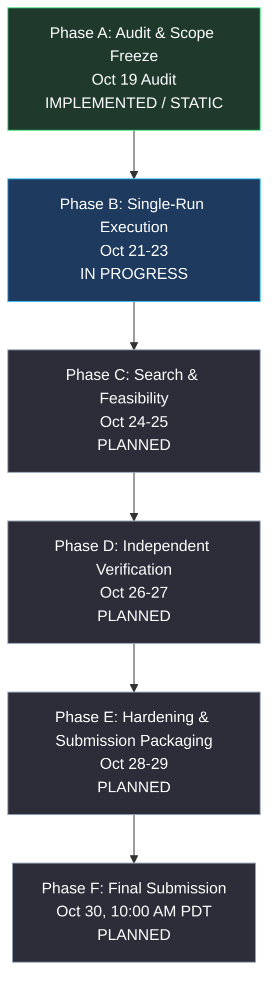
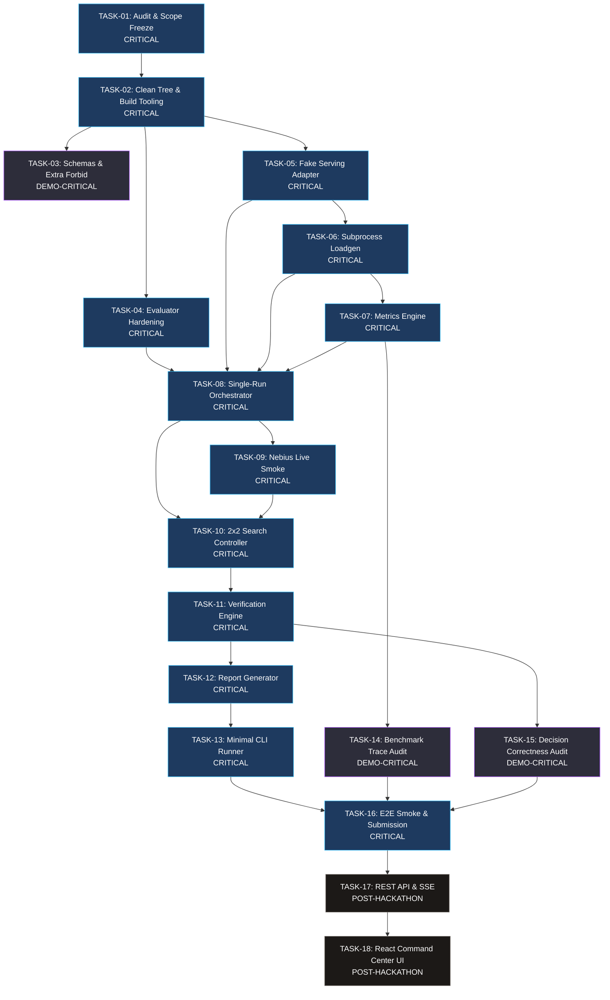

# SLOKern Engineering Roadmap & Delivery Plan

> **Product:** SLOKern — *Optimize inference. Verify performance.*  
> **Status:** Canonical Engineering Roadmap (Updated: October 21, 2026)  
> **Authority:** Aligned with [README.md](README.md), [docs/implementation-status.md](docs/implementation-status.md), and [docs/ownership.md](docs/ownership.md)  
> **Technical Owner:** Rajdeep  
> **Collaborator Workstreams:** Adriraj (Benchmark Integrity, active Oct 21), Daksh (Decision Verification, active Oct 24)  
> **Submission Deadline:** October 30, 2026, 10:00 AM PDT (10:30 PM IST / 17:00 UTC)  
> **Remaining Sprint Time:** 9 days, 13 hours, 40 minutes (~229.7 hours)

---

## 1. Roadmap Architecture & Execution Principles

This roadmap reflects **single-owner core execution with bounded collaborators**. It enforces physical evidence standards: no benchmark result, integration, or capability is marked complete without verified repository evidence.

### Core Delivery Invariants:
1. **Definition of Done:** A task is `DONE` only when its deliverable exists, compiles or runs cleanly, passes automated validation, and is backed by physical evidence.
2. **Deterministic MVP Critical Path:** Critical-path functionality remains executable by Rajdeep without pending collaborator contributions. Collaborators provide independent auditing and integrity validation.
3. **No Unverified Completion Claims:** Tasks are never marked completed merely because their planned calendar date passed.
4. **Mandatory Independent Verification:** A candidate configuration marked `FEASIBLE` during search is never awarded the verified badge until a secondary run under a distinct `verification_run_id` independently satisfies all constraints.
5. **No Fabricated Pricing:** If authoritative cloud provider rates cannot be verified in writing, monetary cost is reported as `unavailable`, and ranking falls back to Mode B (GPU-seconds per request or throughput under SLO).

---

## 2. Milestone Sequence & Current Realities

| Phase | Window | Focus Area | Real Status | Milestone Deliverable & Reality |
|---|---|---|---|---|
| **Phase A** | Oct 19 | Audit & Scope Freeze | `IMPLEMENTED / STATIC` | Baseline audit completed; scope frozen in `docs/implementation-status.md`. Contradicted claims removed. |
| **Phase B** | Oct 21–23 | Establish Single-Run Execution | `IN PROGRESS` | Implement `FakeServingAdapter`, subprocess loadgen, metrics engine, and Nebius live smoke preflight. |
| **Phase C** | Oct 24–25 | Bounded Search & Feasibility | `PLANNED` | Execute 2×2 grid search (4 candidates + 1 baseline), evaluate hard SLO constraints, rank candidates. |
| **Phase D** | Oct 26–27 | Independent Verification | `PLANNED` | Execute independent rerun under fresh `verification_run_id`, compute drift ($\Delta M$), publish Markdown report. |
| **Phase E** | Oct 28–29 | Hardening & Demo Preparation | `PLANNED` | Freeze code, run full automated test suite, verify clean clone installation, record demo video ($\le 3$ min). |
| **Phase F** | Oct 30 | Final Devpost Submission | `PLANNED` | Complete Devpost submission before 10:00 AM PDT (10:30 PM IST) with mandatory tool feedback. |

---

## 3. Dependency Graph & Critical Path

### Critical Path Derivation:
The longest dependency chain among `DEMO-CRITICAL` tasks constitutes the MVP Critical Path:
$$\text{TASK-01} \rightarrow \text{TASK-02} \rightarrow \text{TASK-05} \rightarrow \text{TASK-06} \rightarrow \text{TASK-07} \rightarrow \text{TASK-08} \rightarrow \text{TASK-09} \rightarrow \text{TASK-10} \rightarrow \text{TASK-11} \rightarrow \text{TASK-12} \rightarrow \text{TASK-13} \rightarrow \text{TASK-16}$$

---

## 4. Work Breakdown & Task Specifications

### TASK-01 — Complete Baseline Repository Audit and MVP Scope Freeze
Owner: Rajdeep (CONFIRMED) · Subsystem: SUB-01 · Priority: P0 · Status: IMPLEMENTED / STATIC  
Objective: Replace completion assumptions with verified repository evidence and freeze MVP scope.  
Needs: None  
Deliverables: `docs/implementation-status.md`, `docs/ownership.md`, `ROADMAP.md`  
Acceptance: All subsystems classified by physical reality; zero unverified completion claims; mechanical cross-checks pass.  
Verify: Phase 6 cross-check script execution.  
Done when: Audit deliverables are committed and accepted by Rajdeep.

### TASK-02 — Restore Clean Working Tree Baseline and Hardened Build Tooling
Owner: Rajdeep (CONFIRMED) · Subsystem: SUB-13 · Priority: P0 · Status: PARTIAL / STATIC  
Objective: Clean working tree modifications, declare build dependencies (`wheel`), and ensure reproducible installs.  
Needs: TASK-01, BLK-14, DEC-04  
Deliverables: Reverted or committed `README.md`, updated `pyproject.toml` with build tooling requirements.  
Acceptance: `git status --porcelain` is clean; package installs cleanly via `pip install -e ".[dev]"`.  
Verify: `git status --porcelain` and `pip check` (R-01, R-07).  
Done when: Working tree is clean (`CLEAN-BASELINE`) and offline install is reproducible.

### TASK-03 — Export Committed JSON Schemas and Strict Contract Boundaries
Owner: Rajdeep (CONFIRMED) · Subsystem: SUB-02 · Priority: P1 · Status: IMPLEMENTED / UNIT  
Objective: Generate committed JSON Schemas for all 11 models and configure `model_config = ConfigDict(extra='forbid')`.  
Needs: TASK-02, BLK-10, BLK-12  
Deliverables: `scripts/gen_contracts.py` exporting schemas to `schemas/`, contract models configured with `extra='forbid'`.  
Acceptance: `schemas/` contains 11 committed JSON schema files matching `model_json_schema()`; extra fields rejected.  
Verify: `pytest tests/contract/test_schemas.py` and `python scripts/gen_contracts.py`.  
Done when: All 11 models strictly reject unexpected fields and committed schemas match contract models.

### TASK-04 — Harden Evaluator Boundary Conditions (NaN and Negative Metric Safety)
Owner: Rajdeep (CONFIRMED) · Subsystem: SUB-03 · Priority: P0 · Status: IMPLEMENTED / UNIT  
Objective: Ensure floating-point NaN values evaluate to `INCONCLUSIVE` and negative latencies are rejected.  
Needs: TASK-02, BLK-05, BLK-06  
Deliverables: Patched `src/slokern/core/evaluator/evaluate.py` handling NaN and non-negative boundaries.  
Acceptance: NaN metrics yield `INCONCLUSIVE` with reason `MISSING_REQUIRED_METRIC`; negative latencies fail.  
Verify: `pytest tests/unit/core/test_evaluator.py`.  
Done when: Evaluator passes all boundary and NaN unit tests.

### TASK-05 — Implement Deterministic Fake Serving Adapter
Owner: Rajdeep (INTERIM) · Subsystem: SUB-05 · Priority: P0 · Status: ABSENT / NONE  
Objective: Implement an offline serving adapter generating reproducible synthetic request completions labeled DEMO DATA.  
Needs: TASK-02, BLK-01  
Deliverables: `src/slokern/engine/serving/fake.py` implementing the serving interface.  
Acceptance: Adapter returns predictable completions and timestamps across multiple concurrency levels.  
Verify: `pytest tests/integration/test_pipeline_fake_adapter.py`.  
Done when: Offline single-request and batch simulations execute successfully without external network.

### TASK-06 — Implement Subprocess Load Generator
Owner: Rajdeep (CONFIRMED) · Subsystem: SUB-06 · Priority: P0 · Status: ABSENT / NONE  
Objective: Implement subprocess-isolated load generator generating Poisson/constant arrival and writing unaggregated JSONL events.  
Needs: TASK-05, BLK-02  
Deliverables: `src/slokern/engine/loadgen/runner.py`, `arrival.py`, `recorder.py`.  
Acceptance: Generates traffic at target offered rate and records valid `RawRequestMeasurement` records to JSONL.  
Verify: `pytest tests/unit/engine/loadgen/test_runner.py`.  
Done when: Workload dispatch creates a validated JSONL trace with correct timestamps.

### TASK-07 — Implement Deterministic Metrics Engine
Owner: Rajdeep (CONFIRMED) · Subsystem: SUB-07 · Priority: P0 · Status: ABSENT / NONE  
Objective: Compute percentiles, throughput, error rate, and saturation flags from unaggregated JSONL request traces.  
Needs: TASK-06, BLK-03  
Deliverables: `src/slokern/core/metrics/percentiles.py`, `throughput.py`, `aggregate.py`.  
Acceptance: Derived `MetricSet` accurately matches hand-calculated statistics from fixture JSONL.  
Verify: `pytest tests/unit/core/metrics/test_percentiles.py`.  
Done when: Test suite verifies percentiles, throughput, and generator saturation flags against fixed traces.

### TASK-08 — Implement Single-Run Pipeline Orchestrator
Owner: Rajdeep (INTERIM) · Subsystem: SUB-08 · Priority: P0 · Status: ABSENT / NONE  
Objective: Wire serving adapter, load generator, metrics engine, and evaluator into a single end-to-end execution path.  
Needs: TASK-04, TASK-05, TASK-06, TASK-07  
Deliverables: `src/slokern/engine/runner/run_executor.py` and run persistence.  
Acceptance: Single command executes a candidate, generates measurements, evaluates SLOs, and outputs `RunRecord`.  
Verify: `pytest tests/unit/engine/runner/test_run_executor.py`.  
Done when: A complete single run completes and saves an inspectable artifact directory.

### TASK-09 — Implement Nebius Serving Adapter and Execute Live Smoke Test
Owner: Rajdeep (INTERIM) · Subsystem: SUB-05 · Priority: P0 · Status: ABSENT / NONE  
Objective: Connect to Nebius Cloud endpoint, verify model identifier for `Nemotron-3-Nano-30B-A3B`, and execute live preflight probe.  
Needs: TASK-08, DEC-01, DEC-02, BLK-04  
Deliverables: `src/slokern/engine/serving/nebius.py` and live endpoint smoke test.  
Acceptance: Single-request live smoke test returns HTTP 200 with model string confirmation.  
Verify: `pytest -m live tests/live/test_smoke_live.py`.  
Done when: Live inference call succeeds and records valid environment fingerprints.

### TASK-10 — Implement 2x2 Bounded Search Controller and History Store
Owner: Rajdeep (INTERIM) · Subsystem: SUB-04 · Priority: P0 · Status: PARTIAL / UNIT  
Objective: Enforce 6-run budget (1 baseline + 4 candidates + 1 verification), canonical candidate hashing, and ranking.  
Needs: TASK-08, BLK-11  
Deliverables: `src/slokern/core/search/space.py` (2×2 grid), candidate hashing fix, search controller.  
Acceptance: Executes exactly 5 search runs, evaluates feasibility, and selects winning candidate under declared objective.  
Verify: `pytest tests/unit/core/test_ranker.py`.  
Done when: Multi-candidate search completes within budget and selects the evidenced winning candidate.

### TASK-11 — Implement Independent Verification Engine
Owner: Rajdeep (CONFIRMED) · Subsystem: SUB-09 · Priority: P0 · Status: ABSENT / NONE  
Objective: Orchestrate fresh verification rerun under new run ID, compute metric drift ($\Delta M$), and render `VERIFIED` verdict.  
Needs: TASK-10, BLK-08  
Deliverables: `src/slokern/core/verification/compare.py` and `protocol.py`.  
Acceptance: Rerun executes winning configuration with fresh run ID; drift is computed; verdict rendered.  
Verify: `pytest tests/unit/core/verification/test_compare.py`.  
Done when: Independent verification run completes and outputs a valid `VerificationRecord`.

### TASK-12 — Implement Report Artifact Generator and Markdown Publisher
Owner: Rajdeep (INTERIM) · Subsystem: SUB-10 · Priority: P0 · Status: ABSENT / NONE  
Objective: Serialize complete optimization history, fingerprints, drift, and verdict into an immutable Markdown and JSON report.  
Needs: TASK-11, BLK-09  
Deliverables: `src/slokern/engine/reporting/report_builder.py` and Jinja template.  
Acceptance: Report Markdown renders all sections, links to physical JSONL files, and discloses pricing basis.  
Verify: `pytest tests/unit/engine/reporting/test_report_builder.py`.  
Done when: Publishing creates a self-contained, reviewable `REPORT.md` artifact.

### TASK-13 — Implement Minimal CLI Runner (`slokern verify / optimize / smoke-test`)
Owner: Rajdeep (INTERIM) · Subsystem: SUB-11 · Priority: P0 · Status: ABSENT / NONE  
Objective: Build command-line interface allowing users to run preflight smoke tests, 2×2 optimization, and verification.  
Needs: TASK-12  
Deliverables: `src/slokern/cli/main.py` using standard `argparse`, registered in `pyproject.toml`.  
Acceptance: `slokern verify --spec spec.json` runs pipeline and exits with code 0 on verified pass.  
Verify: `pytest tests/unit/cli/test_main.py`.  
Done when: CLI commands execute the complete pipeline and output structured summaries to stdout.

### TASK-14 — Benchmark Data Integrity and Trace Audit Suite
Owner: Rajdeep (CONFIRMED) · Subsystem: SUB-06 · Priority: P1 · Status: ABSENT / NONE  
Objective: Build comprehensive test suite verifying JSONL trace integrity, metadata completeness, and client saturation detection.  
Needs: TASK-07  
Deliverables: Automated benchmark integrity test suite and trace validation fixtures.  
Acceptance: Test suite detects corrupted JSONL records, invalid timestamps, and client starvation.  
Verify: `pytest tests/contract/test_fixtures_validate.py`.  
Done when: Test suite validates all recorded traces against measurement contracts.

### TASK-15 — Independent Decision Correctness Verification Suite
Owner: Rajdeep (CONFIRMED) · Subsystem: SUB-03 · Priority: P1 · Status: ABSENT / NONE  
Objective: Build independent test suite auditing hard SLO evaluations, reason codes, tie-breaking, and verification verdicts.  
Needs: TASK-11  
Deliverables: Decision verification test suite auditing boundary cases and objective ranking semantics.  
Acceptance: Zero false positives; non-feasible candidates strictly prevented from winning.  
Verify: `pytest tests/contract/test_verification_independence.py`.  
Done when: Decision audit suite passes across all boundary fixtures.

### TASK-16 — End-to-End System Smoke Test and Submission Packaging
Owner: Rajdeep (CONFIRMED) · Subsystem: SUB-01 · Priority: P0 · Status: ABSENT / NONE  
Objective: Validate full pipeline from clean clone install to verified report artifact; compile Devpost submission text and demo runbook.  
Needs: TASK-13, TASK-14, TASK-15  
Deliverables: Submission package, verified demo runbook (`docs/demo-script.md`), tool feedback register (`docs/hackathon-feedback.md`).  
Acceptance: Full automated test suite passes; clean clone install check passes; demo runbook verified.  
Verify: `pytest -v` across entire repository and demo runbook dry-run.  
Done when: Devpost submission package is finalized and archived.

### TASK-17 — Control Plane REST API and SSE Streaming
Owner: Rajdeep (INTERIM) · Subsystem: SUB-11 · Priority: P2 · Status: ABSENT / NONE  
Objective: Implement FastAPI HTTP endpoints and SSE streams for web consumers.  
Needs: TASK-16  
Deliverables: FastAPI routes in `src/slokern/api/`.  
Acceptance: API serves experiment runs and streams progress via SSE.  
Verify: `pytest tests/unit/api/test_app.py`.  
Done when: REST API passes contract tests (Post-Hackathon).

### TASK-18 — Frontend Command Center React UI
Owner: Rajdeep (INTERIM) · Subsystem: SUB-12 · Priority: P2 · Status: ABSENT / NONE  
Objective: Implement React + Vite dashboard displaying experiment telemetry, comparison charts, and verification badges.  
Needs: TASK-17  
Deliverables: React components in `frontend/src/`.  
Acceptance: Web UI connects to API and renders experiment results.  
Verify: `npm run build` and UI visual inspection.  
Done when: Frontend builds cleanly without errors (Post-Hackathon).
