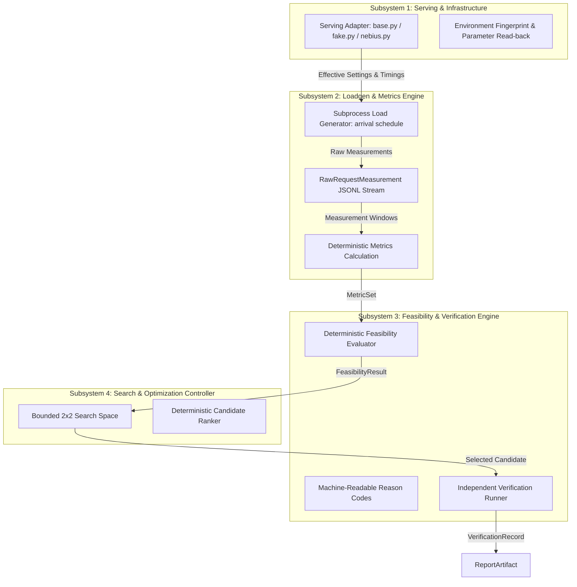
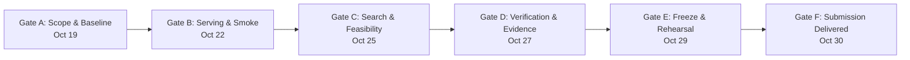

# SLOKern — Execution Roadmap
### Daily work plan, ownership consolidation, dependencies, acceptance gates, and submission readiness

> **Mission:** Deliver a defensible end-to-end SLO-aware inference optimizer—not merely a polished dashboard—by proving that a bounded search can measure candidates, apply deterministic SLO rules, select a candidate, and independently verify it.

**Planning baseline:** October 18, 2026  
**Execution window:** October 18–29, 2026  
**Submission-day buffer:** October 30, 2026  
**Hard submission deadline:** **Friday, October 30, 2026, at 10:00 AM PDT (10:30 PM IST)**  
**Sole accountable technical owner:** Rajdeep (Architecture, Optimizer, Serving, Loadgen, Evaluator, CI/Validation, Documentation/Submission)  
**Historical team context:** Project originally architected by a 5-person team (Rajdeep, Aman, Daksh, Adriraj, Rohan). Effective October 18, 2026, engineering execution is consolidated under Rajdeep as sole technical owner.

> [!IMPORTANT]
> The submission deadline is **October 30, 2026, at 10:00 AM PDT (equivalent to 10:30 PM IST)**. All sprint planning and milestone gates are anchored to this hard cutoff.
>
> This roadmap reflects **single-owner execution** and distinguishes **completed work**, **implemented but unverified work**, **in-progress work**, and **planned work**. No benchmark result, integration, or capability is claimed as complete without repository evidence.
>
> At the start of each day, update task statuses (`TODO`, `IN PROGRESS`, `BLOCKED`, `DONE`) with a commit, test output, or artifact reference.

---

## Contents

1. [Operating rules](#1-operating-rules)
2. [Consolidated engineering ownership and preserved boundaries](#2-consolidated-engineering-ownership-and-preserved-boundaries)
3. [Critical path](#3-critical-path)
4. [Phase map (October 18–30, 2026)](#4-phase-map-october-1830-2026)
5. [Detailed sprint plan by phase](#5-detailed-sprint-plan-by-phase)
6. [Single-owner daily engineering ritual](#6-single-owner-daily-engineering-ritual)
7. [Shared contracts and subsystem interfaces](#7-shared-contracts-and-subsystem-interfaces)
8. [Acceptance gates](#8-acceptance-gates)
9. [Experiment protocol and proof of value](#9-experiment-protocol-and-proof-of-value)
10. [Testing matrix](#10-testing-matrix)
11. [Demo and submission plan](#11-demo-and-submission-plan)
12. [Risk register and contingency decisions](#12-risk-register-and-contingency-decisions)
13. [Definition of done](#13-definition-of-done)
14. [Single-owner daily execution log template](#14-single-owner-daily-execution-log-template)
15. [Decision log template](#15-decision-log-template)

---

## 1. Operating rules

### 1.1 The product promise is the scope boundary

SLOKern accepts a declared workload and SLO specification, measures a bounded set of legal serving configurations, identifies the lowest-cost evidenced feasible candidate under a declared objective, and independently verifies it—or reports honestly that no tested configuration was proven feasible.

The core promise requires:

1. one supported model (`Nemotron-3-Nano-30B-A3B` FP8 as hackathon target candidate; `meta-llama/Meta-Llama-3-8B-Instruct` as comparative baseline);
2. one serving environment (Nebius AI Cloud / Token Factory);
3. one reproducible workload fixture;
4. a bounded configuration space (fixed 2×2 parameter matrix; 4 candidates total);
5. unaggregated raw measurement event logs (`RawRequestMeasurement` in JSONL);
6. deterministic feasibility evaluation and machine-readable reason codes;
7. bounded candidate search, ranker, and selection rationale;
8. an independent verification rerun under a fresh `verification_run_id`;
9. a self-contained report artifact that makes the result inspectable.

Everything else is secondary until this end-to-end chain executes cleanly.

### 1.2 Work in dependency order

The execution order is strictly enforced:

$$\text{Serving smoke test} \to \text{Valid single-run measurement} \to \text{Deterministic evaluator} \to \text{Empirical baseline} \to \text{Bounded search (4 candidates)} \to \text{Selection} \to \text{Independent verification} \to \text{Dashboard/report integration} \to \text{Polished demo}$$

The fake-adapter-first workflow allows developing and verifying the evaluator, metrics calculations, ranker, and dashboard offline using synthetic fixtures. However, all synthetic data must remain explicitly labeled **`DEMO DATA`** and must not delay the real serving path.

### 1.3 No unsupported claims

- Do not invent benchmark numbers or latency improvements.
- Do not call synthetic fixtures or mock runs “live results.”
- Do not claim dollar savings without an authoritative cloud pricing source; default to Mode B (non-monetary systems proxy) and report monetary cost as `unavailable`.
- Do not award a candidate the `VERIFIED` status until an independent rerun under a fresh `verification_run_id` succeeds.
- Do not claim global optimality—report the best verified candidate within the declared 2×2 search space.
- Do not expose a tuning control unless the serving adapter can apply and confirm it via runtime read-back.
- Never hide failed candidates or contaminated runs.

### 1.4 Definition of a task being done

A task is `DONE` only when the deliverable exists, executes or validates, and is backed by evidence. “Code written” is not sufficient.

Acceptable evidence includes:
- a committed file or passing test command output;
- a schema-validated artifact on disk;
- a captured live log or environment fingerprint;
- a documented blocker and recorded decision in [docs/decision-log.md](docs/decision-log.md).

### 1.5 Single-owner daily time allocation

As a single technical owner, context switching must be minimized. The daily engineering schedule allocates:
- **Morning (08:30–09:00):** Daily alignment, critical path blocker review, single highest-value deliverable selection.
- **Deep Work Block 1 (09:00–13:00):** Core engine, contracts, serving, or evaluator implementation.
- **Deep Work Block 2 (14:00–18:00):** Benchmarking, verification, test execution, or UI integration.
- **Evening Integration Checkpoint (18:00–19:30):** Contract test run, git commit, artifact audit, daily log update.

---

## 2. Consolidated engineering ownership and preserved boundaries

### 2.1 Single-owner responsibility matrix

Effective October 18, 2026, **Rajdeep** assumes sole end-to-end technical ownership and integration authority across all 7 functional areas:

| Functional Area | Accountable Owner | Core Responsibilities | Key Deliverables |
|---|---|---|---|
| **1. Architecture & Technical Direction** | **Rajdeep** | Scope boundaries, invariants, state machine, ADRs, interface contracts | `docs/architecture.md`, `src/slokern/contracts/`, decision logs |
| **2. Optimizer & Search Controller** | **Rajdeep** *(Historical: Rohan)* | Legal 2×2 parameter matrix, candidate generation, candidate ranking, stopping rules | `src/slokern/core/search/`, candidate selection logic |
| **3. Serving & Infrastructure** | **Rajdeep** *(Historical: Aman)* | Nebius serving adapter, runtime deployment, parameter read-back, environment fingerprint | `src/slokern/engine/serving/`, smoke test, instance setup |
| **4. Benchmark Pipeline & Loadgen** | **Rajdeep** *(Historical: Adriraj)* | Workload fixtures, load generator subprocess, raw timestamp capture, metrics calculations | `src/slokern/engine/loadgen/`, `src/slokern/core/metrics/` |
| **5. Evaluator & Verification** | **Rajdeep** *(Historical: Daksh)* | Deterministic SLO evaluator, reason codes, independent verification rerun, drift audit | `src/slokern/core/evaluator/`, `src/slokern/core/verification/` |
| **6. CI & End-to-End Validation** | **Rajdeep** | Contract tests, unit test suite, integration smoke tests, automated checks | `tests/`, `.github/workflows/ci.yml` |
| **7. Documentation & Submission** | **Rajdeep** | README, roadmap, compliance matrix, demo script, video recording, Devpost filing | `README.md`, `ROADMAP.md`, demo video, Devpost submission |

### 2.2 Preserved subsystem boundaries

Consolidating ownership does not weaken architectural modularity. The 4 invariant subsystem boundaries remain strictly enforced:



- **Boundary 1 (Serving):** Only parameters confirmed supported via runtime read-back enter the candidate search space.
- **Boundary 2 (Loadgen/Metrics):** Raw event logs are preserved; client saturation flags run contamination (`generator_saturated`).
- **Boundary 3 (Evaluator/Verification):** Evaluator code owns verdicts; missing metric $\ne$ pass; search evidence is never reused as verification.
- **Boundary 4 (Search/Optimizer):** Operates strictly within the 6-run budget (1 baseline + 4 candidates + 1 verification rerun).

---

## 3. Critical path

```text
[Phase A: Scope & Baseline Audit (Oct 18-19)]
              |
              v
[Phase B: Serving Smoke Test & Real Execution (Oct 20-22)]
              |
              v
[Valid Single-Run Measurement Stream (JSONL)]
              |
              v
[Deterministic Feasibility Verdict & Reason Codes]
              |
              v
[Phase C: Bounded 2x2 Search Execution (Oct 23-25)]
              |
              v
[Lowest-Cost Feasible Candidate Selection]
              |
              v
[Phase D: Independent Verification Rerun (Oct 26-27)]
              |
              v
[Phase E: System Freeze, Testing & Rehearsal (Oct 28-29)]
              |
              v
[Phase F: Final Submission (Oct 30, 10:00 AM PDT / 10:30 PM IST)]
```

### Stop-the-line escalation conditions

Stop work and resolve immediately if:
1. Target model (`Nemotron-3-Nano-30B-A3B` FP8) is unreachable or lacks accessible endpoint on Nebius during the Oct 20 smoke test.
2. The serving interface exposes only client request parameters and lacks tunable serving-engine knobs (architectural blocker requiring immediate ADR decision).
3. The load generator cannot maintain the offered schedule and flags `generator_saturated = True`.
4. Monetary cloud rates are unverified while dollar savings claims appear in reports (enforce Mode B immediately).
5. Verification rerun fails or cannot be executed independently under a fresh `verification_run_id`.
6. Dashboard development delays the real inference measurement path.

---

## 4. Phase map (October 18–30, 2026)

| Phase | Dates | Strategic Focus | Target Deliverables & Exit Conditions | Status |
|---|---|---|---|---|
| **Phase A** | **Oct 18–19** | **Audit and stabilize** | Audit contracts, freeze MVP scope, establish single-owner execution baseline, verify fake adapter. | `DONE` (Baseline established Oct 18–19) |
| **Phase B** | **Oct 20–22** | **Establish real execution** | Complete Nebius serving adapter, execute live single-request smoke test, confirm model string, validate measurement capture. | `READY / IN PROGRESS` |
| **Phase C** | **Oct 23–25** | **Validate optimization** | Execute bounded 2×2 candidate search (4 runs) + baseline, record metrics, verify hard SLO feasibility, rank candidates. | `PLANNED` |
| **Phase D** | **Oct 26–27** | **Independent evidence review** | Launch fresh verification rerun under new run ID, audit drift, test edge cases (OOM, invalid runs), review evidence. | `PLANNED` |
| **Phase E** | **Oct 28–29** | **Freeze and prepare** | Freeze code, run full test suite, verify installation from clean checkout, rehearse demo, test fallback runbook. | `PLANNED` |
| **Phase F** | **Oct 30** | **Submit** | Verify Devpost requirements, record submission artifacts, submit before 10:00 AM PDT (10:30 PM IST). | `PLANNED` |

---

## 5. Detailed sprint plan by phase

### Phase A: October 18–19 — Audit and stabilize

**Objective:** Audit current implementation status, freeze core interfaces, establish verified single-owner execution baseline, and validate deterministic fake-adapter pipeline.

- **Status Baseline (October 18, 2026):**
  - Contracts in `src/slokern/contracts/` (`enums.py`, `metrics.py`) are fully implemented and typed with Pydantic v2.
  - Subsystem modules (`engine/`, `core/`, `api/`, `cli/`) exist as scaffolded stubs with clean interface signatures.
  - Demo fixtures in `fixtures/demo/` exist and are labeled **`DEMO DATA`**.
  - Target model `Nemotron-3-Nano-30B-A3B` (FP8) on Nebius is `PENDING RUNTIME VERIFICATION` (blocked on live smoke test).
- **Tasks:**
  1. Complete comprehensive repository preflight audit; reconcile documentation across `AGENTS.md`, `README.md`, `ROADMAP.md`, and all `docs/` files.
  2. Formally document the transition to single-owner technical execution under Rajdeep (`DEC-0011` in `docs/decision-log.md`).
  3. Freeze the 4 invariant subsystem boundaries and Pydantic v2 schemas.
  4. Validate fake adapter (`src/slokern/engine/serving/fake.py`) to ensure deterministic offline development works without GPU dependency.
  5. Audit dependencies (`pyproject.toml`, manifests) and verify no code rewriting occurred during documentation migration.
- **Required Evidence:**
  - Updated documentation suite reflecting single-owner model with historical attribution.
  - Verified clean Git working tree on `main`.
  - Gate A sign-off recorded in `docs/mvp-checklist.md`.

---

### Phase B: October 20–22 — Establish real execution

**Objective:** Complete and validate the real Nebius serving integration, execute preflight smoke test, confirm NVIDIA model accessibility, and verify raw measurement capture.

- **Tasks:**
  1. **Serving Adapter Finalization (`src/slokern/engine/serving/nebius.py`):**
     - Implement OpenAI-compatible HTTP/SSE streaming client targeting Nebius endpoint.
     - Implement environment fingerprint capture (CUDA driver, runtime version, hardware identity).
     - Implement parameter read-back to verify effective settings against requested settings.
  2. **Preflight Endpoint Smoke Test:**
     - Execute 1-request preflight health check against live Nebius endpoint.
     - Confirm reachability (`/health` or `/v1/models`).
     - Read back exact model string for `Nemotron-3-Nano-30B-A3B` (FP8).
     - Verify streaming SSE response headers and client-side TTFT recording.
     - Persist `smoke_test_result.json` artifact.
  3. **Serving Control Verification (Crucial Architecture Check):**
     - Inspect whether endpoint exposes tunable serving-engine knobs (e.g., `max_num_seqs`, `gpu_memory_utilization`).
     - If managed endpoint lacks engine controls, trigger architectural fallback (deploy containerized vLLM on dedicated Nebius Compute GPU instance or refine search boundaries via ADR).
  4. **Empirical Baseline Measurement Run (Run 1 of 6):**
     - Execute baseline benchmark using default serving configuration.
     - Dispatch versioned workload fixture (`fixtures/workloads/default_workload.yaml`).
     - Capture `RawRequestMeasurement` event stream to JSONL.
     - Compute deterministic `MetricSet` and evaluate baseline SLO feasibility.
- **Required Evidence:**
  - Passing `smoke_test_result.json` with live timestamp and confirmed model ID.
  - Raw JSONL event log for baseline run.
  - Baseline `MetricSet` and `FeasibilityResult` artifacts.
  - Gate B sign-off in `docs/mvp-checklist.md`.

---

### Phase C: October 23–25 — Validate optimization

**Objective:** Execute bounded 2×2 candidate search within strict budget, evaluate hard SLO feasibility, and select the winning candidate.

- **Tasks:**
  1. **Search Space Instantiation (`src/slokern/core/search/`):**
     - Lock the 2 specific confirmed dimensions for the 2×2 parameter matrix (4 candidates total).
     - Generate canonical candidate configurations with stable deterministic `candidate_id` hashes.
  2. **Bounded Benchmark Execution (Runs 2 through 5 of 6):**
     - Sequentially evaluate Candidate 1, Candidate 2, Candidate 3, Candidate 4 against the identical workload fixture.
     - Verify effective configuration apply/read-back before each measurement window.
     - Monitor `generator_saturated` flag to ensure client thread starvation does not contaminate runs.
     - Record raw measurement traces (`.jsonl`) for each candidate.
  3. **Deterministic Feasibility Evaluation:**
     - Compute `MetricSet` per candidate (TTFT p50/p95, ITL p95, throughput, error rate).
     - Execute deterministic evaluator (`src/slokern/core/evaluator/`) against declared `SLOSpec`.
     - Assign unambiguous verdicts (`FEASIBLE`, `INFEASIBLE`, `INCONCLUSIVE`) with machine-readable reason codes (`HARD_CONSTRAINTS_PASSED`, `TTFT_P95_EXCEEDED`, etc.).
  4. **Candidate Selection & Objective Ranking:**
     - Apply declared optimization objective (Mode B: GPU-seconds/req or throughput under SLO; Mode A: monetary cost if verified rates exist).
     - Deterministically rank feasible candidates; reject all infeasible/inconclusive candidates.
     - Retain selection rationale and record `SearchResult` artifact.
- **Required Evidence:**
  - Raw JSONL measurement logs for all 4 candidate runs.
  - Complete candidate comparison table with verified metrics and reason codes.
  - Frozen `SearchResult` artifact identifying the winning candidate.
  - Gate C sign-off in `docs/mvp-checklist.md`.

---

### Phase D: October 26–27 — Independent evidence review

**Objective:** Conduct mandatory independent verification rerun of the selected candidate, audit metric drift, test error/edge cases, and verify artifact integrity.

- **Tasks:**
  1. **Independent Verification Rerun (Run 6 of 6):**
     - Freeze the winning candidate configuration selected in Phase C.
     - Assign a brand new, distinct `verification_run_id` (never copy or rename search run data).
     - Execute the identical workload protocol against the live endpoint.
     - Capture fresh raw measurement stream to `verification_measurements.jsonl`.
     - Compute fresh independent `MetricSet` and re-evaluate hard constraints.
  2. **Drift Analysis & Final Verdict:**
     - Compute metric deltas ($\Delta M$) between search run and verification run.
     - Evaluate whether any metric crossed an SLO threshold during verification.
     - Render final verification verdict (`VERIFIED`, `VERIFICATION_FAILED`, `VERIFICATION_INCONCLUSIVE`).
     - Persist `VerificationRecord` artifact.
  3. **Robustness & Edge-Case Testing:**
     - Validate system behavior under simulated edge cases (CUDA OOM, endpoint timeout, noisy client saturation).
     - Verify that execution failures are classified as `FAILED` and never confused with `INFEASIBLE`.
     - Confirm secret redaction (`Bearer ***`, private IPs) across all generated artifacts.
  4. **Report Artifact Generation:**
     - Compile immutable, publishable `ReportArtifact` linking spec, baseline, search history, winning configuration, verification audit, limitations, and raw traces.
- **Required Evidence:**
  - Fresh verification JSONL measurement log with distinct run ID.
  - `VerificationRecord` containing metric deltas and final verification verdict.
  - Schema-valid `ReportArtifact` on disk.
  - Gate D sign-off in `docs/mvp-checklist.md`.

---

### Phase E: October 28–29 — Freeze and prepare

**Objective:** Feature freeze, end-to-end automated testing, installation verification from clean clone, demo video recording, and fallback rehearsal.

- **Tasks:**
  1. **Feature Freeze:** Stop all feature development. Make only fixes strictly necessary for correctness and submission readiness.
  2. **Automated Test Suite Execution:**
     - Run complete unit test suite: contracts, metrics calculation, evaluator reason codes, candidate generator, ranker.
     - Run end-to-end smoke test using the fake adapter.
     - Document test results honestly (passed, skipped, not run).
  3. **Clean Installation Verification:**
     - Verify setup instructions from a clean environment using documented commands (`uv pip install -e .`).
     - Confirm CLI execution (`slokern --help`, `slokern verify`).
  4. **Demo Video Production:**
     - Record, edit, and produce the $\le 3\text{-minute}$ walkthrough video according to [docs/demo-script.md](docs/demo-script.md).
     - Demonstrate: Problem $\to$ Declarative Contract $\to$ Baseline Infeasibility $\to$ Bounded Search $\to$ Independent Verification Rerun $\to$ Auditable Report Artifact.
     - Upload video to YouTube/Vimeo as unlisted/public; record link.
  5. **Demo Fallback Verification:**
     - Test dashboard toggle to archived evidence bundle (`fixtures/demo/demo_experiment.json`).
     - Confirm persistent **`DEMO DATA`** labeling.
- **Required Evidence:**
  - Passing test suite output log.
  - Verified demo video link ($\le 3$ minutes).
  - Tested fallback runbook.
  - Gate E sign-off in `docs/mvp-checklist.md`.

---

### Phase F: October 30 — Submit

**Objective:** Final repository inspection, Devpost submission filing, and submission confirmation well ahead of the deadline.

- **Submission Deadline:** **Friday, October 30, 2026, at 10:00 AM PDT (10:30 PM IST)**.
- **Tasks:**
  1. **Final Repository State Verification (08:00–12:00 IST):**
     - Verify `git status` is clean on `main`.
     - Confirm repository visibility is public.
     - Confirm license is Apache 2.0.
     - Confirm no secrets, API tokens, or unintended temporary files are committed.
  2. **Devpost Form Completion (12:00–16:00 IST):**
     - Title, elevator pitch, and problem description.
     - Track selection: **Coding and Agentic Engineering Track**.
     - Architecture description and link to public GitHub repository.
     - Working demo video link ($\le 3$ minutes).
     - Mandatory tool feedback for Nebius AI Cloud / Token Factory and NVIDIA Nemotron (synthesized from [docs/hackathon-feedback.md](docs/hackathon-feedback.md)).
     - Disclose pre-existing vs fresh code written during the hackathon window.
  3. **Submission Finalization & Buffer (By 18:00 IST / 05:30 AM PDT):**
     - Submit entry at least 4 hours before the 10:00 AM PDT cutoff.
     - Capture submission confirmation receipt and screenshot.
- **Required Evidence:**
  - Timestamped submission confirmation from Devpost.
  - Final repository commit hash recorded.
  - Gate F sign-off in `docs/mvp-checklist.md`.

---

## 6. Single-owner daily engineering ritual

To maintain momentum and rigorous quality as a sole developer:

### Morning Alignment (08:30 IST)
1. What is the single deliverable that moves the critical path today?
2. What dependency or blocker could prevent completion?
3. What is the deterministic fallback if the dependency is unavailable?

### Midday Checkpoint (13:30 IST)
- Review interface consistency against Pydantic schemas.
- If an external dependency (e.g., live GPU) is blocked, pivot immediately to the fake adapter fallback.

### Evening Verification & Log (19:00 IST)
- Run contract and unit tests.
- Commit working progress with descriptive messages.
- Update the daily log template in `ROADMAP.md` Section 14.

---

## 7. Shared contracts and subsystem interfaces

To preserve modularity, all components communicate via canonical Pydantic v2 data models in `src/slokern/contracts/`:

### 7.1 `WorkloadSpec` & `SLOSpec`
- **Purpose:** Defines offered traffic profile (arrival process, rate, durations, token bounds) and non-negotiable hard constraints (TTFT, ITL, throughput, error rate).
- **Consumer:** Subprocess load generator, feasibility evaluator, report generator.

### 7.2 `CandidateConfig`
- **Purpose:** Captures serving parameter values. Distinguishes requested settings from effective settings confirmed via runtime read-back.
- **Consumer:** Serving adapter, search controller, verification runner.

### 7.3 `RawRequestMeasurement`
- **Purpose:** Granular unaggregated request event stream (timestamps, tokens, HTTP code, error classification, warmup flag).
- **Rule:** Written directly to JSONL; raw traces are never discarded.

### 7.4 `MetricSet`
- **Purpose:** Aggregated performance indicators derived deterministically from valid measurement windows. Disambiguates offered load from achieved load; flags `generator_saturated`.

### 7.5 `FeasibilityResult`
- **Purpose:** Deterministic constraint audit emitting `FEASIBLE`, `INFEASIBLE`, or `INCONCLUSIVE` with auditable reason codes.

### 7.6 `SearchResult`
- **Purpose:** Complete exploration record containing candidate summaries, selection rationale, objective ranking, and budget consumption.

### 7.7 `VerificationRecord`
- **Purpose:** Independent rerun audit record containing metric drift deltas ($\Delta M$) and final verification verdict.

### 7.8 `ReportArtifact`
- **Purpose:** Self-contained, immutable bundle containing specs, environment fingerprint, baseline, candidate table, verification record, and raw artifact paths.

---

## 8. Acceptance gates

Advance only when evidence exists on disk:



- **Gate A — Scope & Baseline Stabilized (End of Oct 19):**
  - [x] Ownership consolidated under Rajdeep; historical attribution preserved.
  - [x] Core contracts (`enums.py`, `metrics.py`) implemented; subsystem boundaries locked.
  - [x] Deterministic fake adapter verified for offline development.
  - [x] Documentation suite updated and internally consistent.

- **Gate B — Serving Path & Runtime Verified (End of Oct 22):**
  - [ ] Live Nebius endpoint reachable via serving adapter.
  - [ ] `smoke_test_result.json` saved with confirmed model ID.
  - [ ] Serving-engine parameter read-back confirmed or architectural fallback logged.
  - [ ] Baseline run executed; raw JSONL stream and metrics captured.

- **Gate C — Bounded Optimization Validated (End of Oct 25):**
  - [ ] Bounded 2×2 search space executed (4 candidate runs).
  - [ ] 6-run benchmark budget strictly respected.
  - [ ] Feasibility evaluator emits deterministic verdicts and reason codes.
  - [ ] Lowest-cost feasible candidate selected under declared objective.

- **Gate D — Independent Evidence Reviewed (End of Oct 27):**
  - [ ] Independent verification rerun executed under fresh `verification_run_id`.
  - [ ] Drift analysis computed; final verdict rendered (`VERIFIED` or failed).
  - [ ] Error-handling and OOM protection validated.
  - [ ] Complete `ReportArtifact` compiled with raw evidence links.

- **Gate E — Release Candidate & Demo Frozen (End of Oct 29):**
  - [ ] Feature freeze enforced; automated tests pass.
  - [ ] Setup verified from clean clone.
  - [ ] $\le 3\text{-minute}$ demo video recorded and uploaded.
  - [ ] Demo fallback runbook verified with **`DEMO DATA`** labels.

- **Gate F — Final Submission Delivered (Oct 30):**
  - [ ] Public GitHub repository validated (no secrets, Apache 2.0 license).
  - [ ] Devpost submission completed with video, repo, and tool feedback.
  - [ ] Submission confirmed prior to 10:00 AM PDT (10:30 PM IST).

---

## 9. Experiment protocol and proof of value

### Research question

Under a fixed model (`Nemotron-3-Nano-30B-A3B` FP8), serving environment (Nebius), workload profile, and experiment budget (6 runs), can SLOKern experimentally identify a serving configuration that satisfies the declared SLO at lower measured cost—or discover feasibility more efficiently—than a default baseline configuration, and independently verify that recommendation?

### Budget invariant: Six benchmark runs

1. **Run 1:** Baseline measurement (default configuration).
2. **Runs 2–5:** Bounded candidate search (fixed 2×2 parameter matrix, 4 candidates).
3. **Run 6:** Independent verification rerun of the selected winning candidate.
*(Note: The preflight smoke test is a preliminary health check counted separately).*

### Cost policy & metric disambiguation
- **Mode B (Default):** Monetary cost is reported as **`unavailable`** unless authoritative, verified cloud rates are provided. Candidates are ranked by systems efficiency (GPU-seconds per request or throughput under SLO).
- **Metric Disambiguation:** Disambiguate request throughput (`req/s`), achieved load (`req/s`), and hardware GPU utilization (`%`). Never conflate throughput with hardware utilization.

---

## 10. Testing matrix

All test areas are maintained and executed by **Rajdeep** across the consolidated subsystem boundaries:

| Test Area | Subsystem Boundary | Required Test Cases | Status |
|---|---|---|---|
| **Schema & Contracts** | Architecture | Valid spec, invalid spec, missing required fields, enum validation | `IMPLEMENTED` |
| **Serving Adapter** | Serving (Hist: Aman) | Healthy smoke request, timeout, unavailable endpoint, apply/read-back, OOM handling | `IN PROGRESS` |
| **Loadgen Subprocess** | Benchmarking (Hist: Adriraj) | Arrival schedule timing, generator saturation skew, error handling, JSONL write | `IN PROGRESS` |
| **Metrics Calculation** | Benchmarking (Hist: Adriraj) | Percentiles (p50/p95/p99), zero samples, error rate denominator, offered vs achieved | `IMPLEMENTED` |
| **Feasibility Evaluator** | Evaluator (Hist: Daksh) | Boundary thresholds (`<=`, `>=`), missing metrics, inconclusive outcomes, reason codes | `IMPLEMENTED` |
| **Search & Ranker** | Optimizer (Hist: Rohan) | Stable candidate hashing, duplicate prevention, budget exhaustion, objective ranking | `IN PROGRESS` |
| **Verification Runner** | Evaluator (Hist: Daksh) | Distinct run ID, metric drift computation, verification failure, rerun isolation | `IN PROGRESS` |
| **Security & Redaction** | Architecture / Serving | Token masking (`Bearer ***`), private IP masking, environment secret hygiene | `IMPLEMENTED` |

---

## 11. Demo and submission plan

### Presentation structure (3–5 minutes, solo delivery)

1. **Act 1: The Dilemma (30s):** Why unconstrained throughput is dangerous; the need for SLO-aware optimization.
2. **Act 2: Declarative Specification (45s):** Workload profile, hard SLO constraints, budget ceiling.
3. **Act 3: Baseline Reality (45s):** Default configuration benchmarked; fails tail latency constraint (`INFEASIBLE`).
4. **Act 4: Bounded Search (60s):** Bounded 2×2 search space; candidates evaluated; feasible candidate identified.
5. **Act 5: Independent Verification (60s):** Mandatory rerun under fresh `verification_run_id`; drift audit; verified badge.
6. **Act 6: Traceable Evidence (30s):** Report artifact, raw JSONL traces, disclosed limitations.

### Fallback runbook
If live cloud endpoint connectivity is interrupted during the presentation:
- Toggle dashboard to pre-recorded evidence bundle (`fixtures/demo/demo_experiment.json`).
- Openly disclose: *"Demonstrating an evidence bundle measured earlier on our Nebius NVIDIA GPU instance."*
- Ensure persistent **`DEMO DATA`** label remains visible.

---

## 12. Risk register and contingency decisions

All risks are monitored and managed by **Rajdeep**:

| Risk | Trigger | Immediate Contingency Response |
|---|---|---|
| **Model/runtime inaccessible** | Smoke test fails on Nebius by Oct 20 | Test alternative permitted endpoint; if blocked, pivot to containerized vLLM on Compute GPU instance. |
| **Endpoint lacks serving-engine knobs** | Runtime read-back reveals only client params | Log architectural blocker; deploy containerized vLLM on dedicated instance or refine search boundaries via ADR. |
| **Benchmark generator saturates** | Dispatch delay > 10ms or load drops > 10% | Mark run `CONTAMINATED` (`INCONCLUSIVE`); adjust client worker concurrency before re-evaluating. |
| **Candidate setting not applied** | Effective config $\ne$ requested config | Mark parameter unsupported; drop dimension from search space. |
| **Verification rerun fails** | Fresh run breaches an SLO constraint | Render `VERIFICATION_FAILED`; report honestly; never award verified status. |
| **Cost data unconfirmed** | No verified cloud rate card available | Default to Mode B; declare monetary cost `unavailable`; rank by GPU-seconds/req or throughput under SLO. |
| **UI takes excessive time** | Backend pipeline at risk on Oct 24 | Freeze dashboard to essential views; prioritize CLI and report artifact. |
| **Claims exceed evidence** | Slide/doc claims lack raw JSONL artifact | Remove or qualify claim immediately; zero tolerance for unsupported claims. |

---

## 13. Definition of done

The SLOKern MVP is complete only when:

- [ ] A valid workload and SLO specification can be declared and validated.
- [ ] The target NVIDIA model responds through the serving path.
- [ ] The effective serving configuration is recorded via runtime read-back.
- [ ] An empirical baseline produces raw JSONL measurements and reproducible metadata.
- [ ] Metrics are calculated deterministically according to documented rules.
- [ ] Offered load and achieved load are separated; client saturation is detected.
- [ ] Feasibility evaluator emits deterministic per-constraint verdicts and reason codes.
- [ ] Bounded 2×2 candidate search executes automatically within budget.
- [ ] Infeasible and invalid candidates remain visible with explanation.
- [ ] Winner selection uses a declared objective function.
- [ ] The winner undergoes a mandatory independent verification rerun with a fresh run ID.
- [ ] Verification verdict is derived independently from verification evidence.
- [ ] Report artifact links specification, environment fingerprint, search history, and raw traces.
- [ ] All synthetic fixtures and demo modes are clearly labeled **`DEMO DATA`**.
- [ ] Setup and execution work cleanly from a fresh checkout.
- [ ] Demo video ($\le 3$ minutes) is recorded and uploaded.
- [ ] Devpost submission is complete before October 30, 10:00 AM PDT (10:30 PM IST).

---

## 14. Single-owner daily execution log template

Record at the end of each day in sprint records:

```text
Date: 2026-10-XX
Phase: [Phase A / B / C / D / E / F]
Owner: Rajdeep

Today's Primary Deliverable:
- Description:
- Commit / File / Artifact:
- Test Output / Verification Evidence:

Blockers & Resolution:
- Identified Blocker:
- Contingency Action Taken:

Subsystem Boundary Checks:
- Serving: [OK / Blocked]
- Loadgen: [OK / Blocked]
- Evaluator: [OK / Blocked]
- Search: [OK / Blocked]

Critical Path Status: [ON TRACK / AT RISK / BLOCKED]
Tomorrow's Next Priority:
```

---

## 15. Decision log template

Use for all architectural or policy changes (see [docs/decision-log.md](docs/decision-log.md)):

```text
Decision ID: DEC-XXXX
Date: 2026-10-XX
Question:
Options Considered:
Decision:
Reason:
Owner: Rajdeep
Affected Subsystems & Contracts:
Evidence & Verification:
Trade-offs & Limitations:
Revisit Condition:
```

---

## Final operating principle

Build the smallest complete system that can **measure, decide, verify, and explain**.

SLOKern does not claim universal optimality. It proves that its recommendation follows from controlled measurements, deterministic rules, a declared objective, and an independent verification run.

**Optimize inference. Verify performance.**
