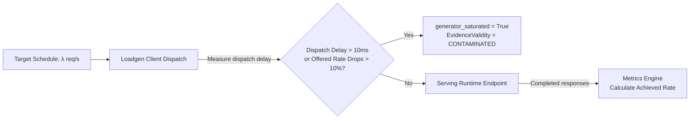

# SLOKern Experiment & Measurement Methodology

> **Product:** SLOKern — *Optimize inference. Verify performance.*  
> **Status:** Active Specification (Methodology Version: 1.0.0)  
> **Owner:** Rajdeep (Architecture, Benchmarking & Experiments; Historical design: Adriraj)  
> **Authority:** Aligned with [README.md](../README.md), [ROADMAP.md](../ROADMAP.md), and [docs/ownership.md](ownership.md)

---

## 1. Methodology Philosophy & Research Question

The core research question investigated by SLOKern is:

> **Under a fixed model, serving environment, workload profile, and experiment budget, can SLOKern experimentally identify a legal serving configuration that satisfies the declared SLO at lower measured cost—or discover feasibility more efficiently—than a default baseline configuration, and independently verify that recommendation?**

To answer this defensibly, benchmark measurements must be rigorously controlled, reproducible, and immune to client-side measurement artifacts.

---

## 2. Workload & Traffic Protocol

### 2.1 Prompt Fixtures
Benchmarks utilize versioned, deterministic prompt fixtures (`fixtures/workloads/`). 
- **Fixed Token Budgets:** Every prompt in the fixture specifies a target input token length (e.g., 512 tokens) and an output generation ceiling (e.g., 128 tokens) to prevent prompt variance from skewing latency observations.
- **Fixture Provenance:** Every run records the fixture path and content hash in the experiment metadata.

### 2.2 Traffic Arrival Processes
SLOKern supports three arrival models configured in `WorkloadSpec`:

1. **Poisson Arrival Process (Open Loop - Default):**
   - Inter-arrival times are exponentially distributed: $\Delta t \sim \text{Exp}(\lambda)$, where $\lambda$ is `target_offered_rate`.
   - Simulates realistic, bursty user traffic where new requests arrive independently of whether previous requests have completed.
2. **Constant Rate (Open Loop):**
   - Requests are dispatched at deterministic intervals: $\Delta t = \frac{1}{\lambda}$.
   - Ideal for stress testing queuing thresholds and measuring steady-state pipeline behavior.
3. **Closed Concurrency Loop:**
   - A fixed pool of $N$ client threads continuously issues requests: a new request is dispatched immediately upon completion of the previous request.
   - Measures maximum saturating throughput under fixed concurrency.

---

## 3. Warm-Up vs. Active Measurement Windows

A major source of flawed benchmark reporting is including cold-start samples in summary statistics. SLOKern enforces strict temporal partitioning:

```text
|<------------- Total Run Duration ------------->|
|-- Warm-Up Window --|---- Active Measurement Window ----|
[0s                 15s]                              [60s]
  (Engine JIT, KV        (All samples recorded to JSONL;
   allocation, CUDA       used for MetricSet percentiles)
   cache warming)
```

### 3.1 Warm-Up Window (`warmup_duration_s`)
- **Duration:** Typically 10–30 seconds depending on model size.
- **Purpose:** Warms CUDA memory allocations, pre-allocates KV-cache pages, populates instruction caches, and brings GPU clock frequencies to steady state.
- **Exclusion Rule:** Requests initiated during the warm-up window are marked `is_warmup = true` in raw logs and are **strictly excluded** from all `MetricSet` percentile calculations and SLO evaluations.

### 3.2 Active Measurement Window (`measurement_duration_s`)
- **Duration:** Typically 30–120 seconds.
- **Execution:** Requests dispatched during this window represent the true steady-state performance. Only samples with `is_warmup = false` are analyzed by the metrics engine.

---

## 4. Offered vs. Achieved Load & Generator Saturation

A fundamental requirement in systems benchmarking is verifying that the benchmark client actually delivered the intended workload.



### Generator Saturation Detection
The subprocess load generator logs two timestamps for every request:
1. `scheduled_at`: Theoretical dispatch time dictated by the arrival schedule.
2. `sent_at`: Actual time socket transmission began.

If the load generator experiences thread starvation, high garbage collection latency, or CPU saturation:
$$\Delta t_{\text{dispatch\_skew}} = \text{sent\_at} - \text{scheduled\_at}$$
- If mean dispatch skew exceeds 10 milliseconds, or if the offered rate falls below 90% of the target rate, SLOKern flags:
  `generator_saturated = true`
- The run is tagged with `validity_status = CONTAMINATED`.
- **Consequence:** An evaluated candidate cannot be declared `FEASIBLE` under a contaminated run; the verdict is set to `INCONCLUSIVE` (`CONTAMINATED_LOAD`). This prevents falsely passing a slow server because the benchmark generator failed to deliver traffic.

---

## 5. Raw Event Capture (`RawRequestMeasurement`)

The load generator writes every individual request event directly to a local JSONL file (`artifacts/experiments/<id>/runs/<run_id>/raw_measurements.jsonl`):

```json
{
  "request_id": "req-0042a9b1",
  "run_id": "run-f19b02",
  "scheduled_at": 1792218400.100234,
  "sent_at": 1792218400.101012,
  "first_token_at": 1792218400.145620,
  "completed_at": 1792218400.312450,
  "http_status": 200,
  "input_tokens": 512,
  "output_tokens": 128,
  "is_warmup": false,
  "is_valid": true,
  "error_type": null
}
```

By persisting raw events rather than merely aggregates, any metric or percentile can be recalculated, audited, or plotted offline.

---

## 6. Fairness & Experimental Controls

To ensure scientific validity when comparing multiple candidates:

1. **Hardware & Environment Lock:** Hardware tier, GPU driver, CUDA version, container image, and OS kernel must remain unchanged across baseline, candidate search, and verification.
2. **Identical Workload Protocols:** Every candidate is tested using the exact same fixture, arrival rate, duration, and token limits.
3. **Configuration Isolation:** Between candidate runs, the serving adapter resets active state and verifies effective settings via read-back before beginning the warm-up window.

---

## 7. Related Documentation

- [System Architecture](architecture.md)
- [Metrics Definitions & Aggregation Rules](metrics.md)
- [Decision Policy & Feasibility Semantics](decision-policy.md)
- [Serving Deployment Notes](deployment.md)
- [ADR 0001: MVP Scope & Evidence Policy](adr/0001-mvp-scope-and-evidence.md)

