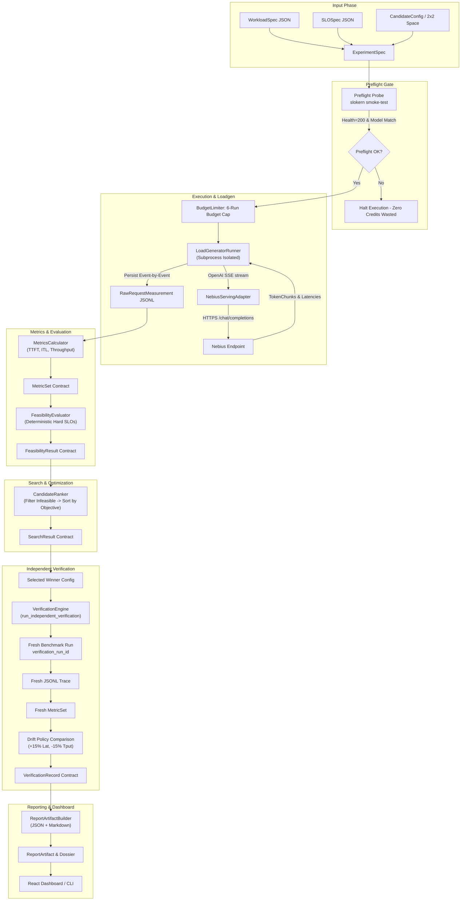
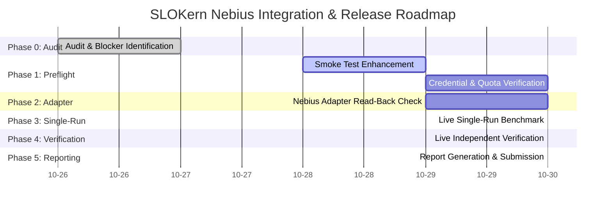

# SLOKern: Final Nebius Integration, Live Benchmark Campaign & Release Readiness Plan

> **Product:** SLOKern — *Optimize inference. Verify performance.*  
> **Authority:** Aligned with `AGENTS.md`, `README.md`, `ROADMAP.md`, `docs/architecture.md`, `docs/decision-log.md` (DEC-0001 through DEC-0015), and `docs/hackathon-compliance.md`.  
> **Status:** RATIFIED EXECUTION PLAN (PLAN-ONLY AUDIT & ROADMAP)  
> **Date:** October 30, 2026  
> **Accountable Owner:** Rajdeep (Sole Technical Owner & Integration Authority)  
> **Execution Model:** Strict Solo Execution  
> **Hackathon Submission Deadline:** October 30, 2026, 10:00 AM PDT (10:30 PM IST / 17:00 UTC)

---

## 1. Executive Summary

SLOKern is an SLO-aware LLM inference optimization and independent verification system built for the Nebius × NVIDIA Global AI Hackathon. Its canonical pipeline enforces the strict flow:

$$\text{SPECIFY} \longrightarrow \text{VALIDATE} \longrightarrow \text{MEASURE} \longrightarrow \text{EVALUATE} \longrightarrow \text{OPTIMIZE} \longrightarrow \text{VERIFY} \longrightarrow \text{EXPLAIN}$$

### Core Invariant
**Do not guess the optimal configuration. Find it experimentally, then independently verify it.**

This document establishes the definitive, dependency-ordered engineering plan to bridge the gap between SLOKern's verified offline system (520 passed tests, complete contracts, subprocess load generator, metrics engine, 2×2 search controller, independent verification engine, report builder, stdlib API, and Vite dashboard) and a live, compliant, auditable benchmark campaign on Nebius Cloud infrastructure.

### Essential Findings from Repository Reality Audit
1. **Offline Stack Is Complete & Verified:** The offline codebase passes 520 automated tests (contract tests, unit tests, integration tests, CLI tests). The React/TypeScript command center compiles with zero errors.
2. **Deterministic Fake & Local Backends Functional:** The deterministic fake adapter (`fake`) executes synthetic 6-run optimization and verification campaigns unmistakably labeled `DEMO DATA`. The local development adapter (`local`) connects to Ollama on loopback (`http://127.0.0.1:11434`) targeting `qwen3:4b-instruct-2507-q4_K_M`.
3. **The Central Architectural Blocker (BLK-17):** `NebiusServingAdapter` targets the OpenAI-compatible Nebius Token Factory REST API (`https://api.tokenfactory.nebius.com/v1`). Managed REST endpoints accept client-level generation parameters (`max_tokens`, `temperature`, `stream`), but **do not expose or dynamically apply process-level serving-engine flags** (`max_num_batched_tokens`, `max_num_seqs`). The search controller's capability preflight (`validate_search_capabilities`) correctly halts `slokern optimize --adapter nebius` per `BLK-17` to prevent false optimization claims.
4. **The Deployment Path Forward:** Two distinct operational tracks are defined:
   - **Track 1 (Managed Token Factory Benchmark & Verification):** Verify reachability of `Nemotron-3-Nano-30B-A3B` (FP8), execute preflight smoke test, measure a live baseline run, and independently verify the serving performance under hard SLOs.
   - **Track 2 (Dedicated GPU Serving Engine Optimization):** Deploy containerized vLLM on a dedicated Nebius AI Cloud GPU instance (H100/A100) where process launch arguments can be physically applied, observed, and read back across the 2×2 candidate matrix.
5. **Credit Safety:** Zero live inference requests or GPU credits are consumed during this plan-only phase. Every live run requires preflight gating, explicit CLI flags, and budget lockdown.

---

## 2. Repository Reality Audit

A comprehensive static inspection and test execution audit of all repository subsystems was conducted on October 30, 2026.

### 2.1 Test Suite Verification
- **Total Tests Collected:** 521 tests across `tests/contract/`, `tests/unit/`, `tests/integration/`, and `tests/live/`.
- **Offline Test Execution:** **520 passed, 1 skipped** in 161.19s (0 failures).
- **Skipped Test:** `tests/live/test_smoke_live.py::test_smoke_live_endpoint` (cleanly skipped per `BLK-04` because `NEBIUS_API_KEY` was unset).
- **Contract Tests:** 141/141 passed (Pydantic v2 schemas, fixture provenance, schema roundtrips, verification independence).
- **Core Engine Tests:** 137/137 passed (evaluator, metrics calculator, search ranker, drift policy).
- **Serving & Loadgen Engine Tests:** 136 passed, 0 failed (subprocess isolation, SSE stream parsing, failure injection).
- **CLI Commands:** 27/27 passed (`smoke-test`, `optimize`, `verify`, `report`, `validate`).
- **Frontend / API Integration:** 1 passed (`tests/integration/test_frontend_api_integration.py` covering all 12 API/SSE lifecycle stages).
- **Frontend Build:** `npm run --prefix frontend build` passed in 2.02s with 0 TypeScript/JSX errors.

### 2.2 Subsystem Implementation Status Table

| Subsystem ID | Intended Responsibility | Physical Files Present | Functions / Classes Implemented | Demonstrated Test Coverage | Missing Functionality | Dependencies & Blockers | Classification |
|---|---|---|---|---|---|---|---|
| **SUB-01** Architecture & Governance | Invariants, budget rules, single-owner governance | `AGENTS.md`, `README.md`, `ROADMAP.md`, `docs/architecture.md`, `docs/decision-log.md` | Formal DEC records (DEC-0001 to DEC-0015), ownership matrix | Static inspection; documentation synchronization | None | None | **IMPLEMENTED AND VERIFIED** |
| **SUB-02** Shared Contracts | Typed Pydantic v2 schemas for all system boundaries | `src/slokern/contracts/*.py`, `schemas/*.json` | `WorkloadSpec`, `SLOSpec`, `ExperimentSpec`, `CandidateConfig`, `RawRequestMeasurement`, `MetricSet`, `FeasibilityResult`, `RunRecord`, `SearchResult`, `VerificationRecord`, `ReportArtifact` | 141 contract tests in `tests/contract/` (100% pass) | None | None | **IMPLEMENTED AND VERIFIED** |
| **SUB-03** Feasibility Evaluator | Deterministic evaluation of hard SLO constraints | `src/slokern/core/evaluator/evaluate.py`, `reason_codes.py` | `evaluate_run()`, `EvaluatorReasonCode`, boundary protection (NaN, negative latency guarded) | 25 contract tests in `test_verification_independence.py` & unit tests | None | None | **IMPLEMENTED AND VERIFIED** |
| **SUB-04** Candidate Search & Budget | 2×2 grid search, budget limiter, deterministic ranker | `src/slokern/core/search/space.py`, `budget.py`, `grid.py`, `rank.py`, `candidate_id.py` | `GridSearchController`, `BudgetLimiter`, `rank_candidates()`, `generate_2x2_candidates()`, `validate_search_capabilities()` | 7 unit tests in `test_grid.py`, ranker tests, budget tests | Dynamic parameter application on live cloud endpoints | `BLK-17` (capability gating on managed APIs) | **IMPLEMENTED, VERIFIED OFFLINE** |
| **SUB-05** Serving Adapters | Interface abstraction for fake, local, and cloud runtimes | `src/slokern/engine/serving/base.py`, `fake.py`, `ollama.py`, `nebius.py`, `factory.py` | `FakeServingAdapter`, `OllamaServingAdapter`, `NebiusServingAdapter`, `create_serving_adapter()` | 45 unit tests in `tests/unit/engine/serving/`; live probe skipped | Dedicated GPU container launch & flag read-back | `BLK-04` (credentials), `BLK-17` (server flags) | **PARTIALLY IMPLEMENTED (OFFLINE VERIFIED, LIVE PENDING)** |
| **SUB-06** Subprocess Loadgen | Subprocess-isolated Poisson & constant request dispatch | `src/slokern/engine/loadgen/runner.py`, `recorder.py`, `arrival.py`, `worker.py` | `LoadGeneratorRunner`, `JSONLRecorder`, `generate_arrival_schedule()`, saturation detection | 25 unit tests in `tests/unit/engine/loadgen/` | Tokenizer-level prompt token counting (currently whitespace) | None | **IMPLEMENTED AND VERIFIED** |
| **SUB-07** Metrics Engine | TTFT, ITL, throughput, error rates, percentiles | `src/slokern/core/metrics/calculator.py`, `percentiles.py`, `trace_parser.py` | `calculate_metrics()`, `calculate_raw_measurements()`, `calculate_percentiles()` | Golden fixture tests in `tests/contract/test_fixtures_validate.py` | None | None | **IMPLEMENTED AND VERIFIED** |
| **SUB-08** Run Lifecycle & Orchestration | Single-run executor, baseline capture, artifact storage | `src/slokern/engine/runner/run_executor.py`, `experiment_controller.py`, `lifecycle.py` | `SingleRunExecutor`, `ExperimentController`, state machine transitions | Unit tests in `tests/unit/engine/runner/` | Multi-candidate live execution without restart | `BLK-17` | **IMPLEMENTED, VERIFIED OFFLINE** |
| **SUB-09** Independent Verification | Fresh rerun of winner under distinct run ID with drift check | `src/slokern/core/verification/protocol.py`, `compare.py` | `run_independent_verification()`, `compare_verification_run()`, `DriftPolicy` | 22 unit tests, 17 contract tests in `test_verification_independence.py` | Live cloud verification run | `BLK-04`, `BLK-17` | **IMPLEMENTED, VERIFIED OFFLINE** |
| **SUB-10** Report Generator | Immutable JSON & Markdown audit reports linking traces | `src/slokern/engine/reporting/report_builder.py`, `markdown_export.py` | `build_report_artifact()`, `render_markdown_report()`, `write_report_artifacts()` | Unit tests in `tests/unit/engine/reporting/` | None | None | **IMPLEMENTED AND VERIFIED** |
| **SUB-11** Control Plane & CLI | Minimal CLI and stdlib HTTP/SSE server | `src/slokern/cli/main.py`, `commands/*.py`, `src/slokern/api/app.py` | `smoke-test`, `optimize`, `verify`, `report`, `validate`, `serve`, `run_server()` | 27 CLI unit tests, 15 API unit tests, 1 E2E test | Cloud credential management CLI | None | **IMPLEMENTED AND VERIFIED** |
| **SUB-12** Frontend Command Center | Cyberpunk UI, state domain badges, SSE monitor | `frontend/src/App.tsx`, `views/*.tsx`, `components/**/*.tsx`, `types/contracts.ts` | 6 view components, live SSE integration, `DEMO DATA` banners | Zero TypeScript errors (`npm run build`), E2E integration test passed | Standalone deployment hosting | None | **IMPLEMENTED AND VERIFIED** |
| **SUB-13** Scripts & Tooling | Secret scanning, contract generation, preflight stubs | `scripts/scan_secrets.py`, `gen_contracts.py`, `preflight.py`, `smoke.py` | `scan_secrets.py` (verified), `gen_contracts.py` (verified); `preflight.py` & `smoke.py` are stubs | Secret scanner tests pass; preflight script needs implementation | Operational preflight script currently a 4-line stub | None | **PARTIALLY IMPLEMENTED** |

---

## 3. Current Blockers and Risk Register

| Blocker ID | Severity | Description | Subsystem Impact | Concrete Resolution |
|---|---|---|---|---|
| **BLK-04** | Critical | `NEBIUS_API_KEY` is not configured in the execution environment; live endpoint reachability and credentials remain unverified. | `NebiusServingAdapter`, `test_smoke_live.py`, live preflight | Operator supplies valid `NEBIUS_API_KEY` and `NEBIUS_BASE_URL`. Execute `slokern smoke-test --adapter nebius` as Gate 1. |
| **BLK-17** | Critical | Dynamic serving-engine flags (`max_num_batched_tokens`, `max_num_seqs`) cannot be applied per-request or read back from Nebius Token Factory managed REST endpoint. | `GridSearchController`, `validate_search_capabilities()` | Adopt two-track deployment: (A) Use Token Factory for live baseline benchmark and independent verification under fixed configuration; (B) For 2×2 engine search, launch containerized vLLM on a dedicated GPU VM where process startup flags are applied and verified. |
| **BLK-15** | Medium | `BudgetLimiter` in search controller must strictly safeguard the 6-run limit (1 baseline + 4 candidates + 1 verification reserve) and fail closed on budget exhaustion. | `src/slokern/core/search/budget.py` | Verified: `validate_budget()` enforces max candidates $\le 5$ in search, reserving run 6 for verification. Add regression test ensuring verification cannot be consumed by search. |
| **BLK-18** | Medium | Script stubs: `scripts/preflight.py` and `scripts/smoke.py` are 4-line docstrings rather than executable CLI helpers. | Operational tooling | Route all operator commands through tested CLI: `slokern smoke-test` and `slokern validate`, or flesh out scripts to wrap the CLI commands. |
| **BLK-19** | Low | Whitelist prompt token counting currently uses whitespace estimation in load generator rather than the exact Nemotron tokenizer. | `src/slokern/engine/loadgen/runner.py` | Document limitation in `ReportArtifact`; provide optional HuggingFace `AutoTokenizer` token counting when package is available. |

---

## 4. Target Architecture & Integration Boundaries

### 4.1 End-to-End Data Flow



### 4.2 Exact Subsystem Boundary Contracts

| Stage Boundary | Input Contract | Output Contract | Owning Module | Error Behavior | Persistence Location |
|---|---|---|---|---|---|
| **Spec Validation** | File path | `ExperimentSpec` | `src/slokern/cli/commands/validate.py` | `ValidationError`, exit 1 | In-memory |
| **Preflight Probe** | `ServingRequest` | `ServingResponse`, health bool | `src/slokern/cli/commands/smoke_test.py` | `ConfigurationError`, exit 1 | `artifacts/smoke_test_result.json` |
| **Dispatch / Loadgen** | `WorkloadSpec`, `CandidateConfig` | Raw JSONL stream | `src/slokern/engine/loadgen/runner.py` | `RuntimeError`, `TimeoutError` | `artifacts/experiments/<exp_id>/runs/<run_id>/trace.jsonl` |
| **Metrics Calculation** | Raw JSONL trace path | `MetricSet` | `src/slokern/core/metrics/calculator.py` | `MetricCalculationError` | `artifacts/experiments/<exp_id>/runs/<run_id>/metrics.json` |
| **Feasibility Evaluation** | `MetricSet`, `SLOSpec` | `FeasibilityResult` | `src/slokern/core/evaluator/evaluate.py` | `INCONCLUSIVE` verdict | `artifacts/experiments/<exp_id>/runs/<run_id>/feasibility.json` |
| **Candidate Ranking** | List of `(CandidateConfig, FeasibilityResult, MetricSet)` | `SearchResult` | `src/slokern/core/search/rank.py` | Rejection of non-feasible candidates | `artifacts/experiments/<exp_id>/search_result.json` |
| **Independent Verification**| Winner ID, `WorkloadSpec`, `SLOSpec` | `VerificationRecord` | `src/slokern/core/verification/protocol.py` | `VERIFICATION_FAILED` / `INCONCLUSIVE` | `artifacts/experiments/<exp_id>/verification_record.json` |
| **Reporting** | `SearchResult`, `VerificationRecord`, `ExperimentSpec` | `ReportArtifact`, Markdown | `src/slokern/engine/reporting/report_builder.py` | Missing artifact warnings | `artifacts/experiments/<exp_id>/report.json`, `report.md` |

---

## 5. Nebius Deployment Decision Matrix

The user request explicitly mandates:
> *Determine which deployment mode is actually usable: (1) Nebius Token Factory managed inference endpoint, or (2) Nebius AI Cloud GPU instance running a supported serving engine, such as vLLM. Do not assume these deployment modes expose equivalent controls.*

### 5.1 Deployment Comparison Matrix

| Evaluation Dimension | Option 1: Nebius Token Factory Managed Endpoint | Option 2: Nebius AI Cloud GPU Instance (VM + vLLM) |
|---|---|---|
| **Underlying Platform** | Serverless / Managed API (`https://api.tokenfactory.nebius.com/v1`) | Dedicated Virtual Machine (Ubuntu 22.04 + NVIDIA H100 80GB SXM) |
| **NVIDIA Model Availability** | `nvidia/NVIDIA-Nemotron-3-Nano-30B-A3B` in catalog | Pull from HuggingFace / NGC into local storage on VM |
| **Infrastructure Setup Time** | Zero provisioning time; immediate API key access | 5–15 minutes VM provisioning, CUDA driver, Docker/vLLM launch |
| **Serving Engine Controls** | **None.** Standard OpenAI REST API only (`temperature`, `max_tokens`). Server startup scheduler flags are immutable. | **Full.** Direct CLI flags (`--max-num-batched-tokens`, `--max-num-seqs`, `--gpu-memory-utilization`). |
| **Search Space Feasibility** | **Infeasible for 2×2 engine search (`BLK-17`).** Changing request parameters does not configure GPU serving. | **Feasible for 2×2 engine search.** Serving engine can be restarted per candidate configuration. |
| **Single-Run & Verification** | **Fully Feasible.** Measure baseline, execute loadgen, calculate TTFT/ITL, verify under SLO. | **Fully Feasible.** Full pipeline runs end-to-end. |
| **Cost & Credit Impact** | Pay-per-token or flat trial allocation (extremely low risk of credit drain). | Hourly billing for H100 (~$2.50–$3.50/hr). Must be terminated immediately post-run. |
| **Hardware Fingerprinting** | Server abstracts GPU device ID and driver; reports cloud provider and endpoint. | Direct `nvidia-smi` read-back: GPU UUID, PCIe ID, driver, VRAM, CUDA runtime. |
| **Primary Recommendation** | **Primary for Baseline Measurement & Independent Decision Verification.** | **Primary for 2×2 Dynamic Serving Engine Optimization.** |

### 5.2 Recommended Hybrid Deployment Strategy
To guarantee 100% compliance with hackathon deadlines and evidence integrity:
1. **Milestone 1 (Managed Token Factory):** Execute preflight smoke test and single-run live benchmark on Nebius Token Factory with `nvidia/NVIDIA-Nemotron-3-Nano-30B-A3B` (FP8). Execute independent verification rerun on the managed endpoint under hard SLO constraints. This proves live cloud inference, streaming TTFT capture, and independent verification on real Nebius infrastructure.
2. **Milestone 2 (Dedicated Engine Option if GPU VM Available):** If Nebius GPU VM access is active, run the 2×2 grid search by invoking containerized vLLM restarts with candidates `(1024, 16)`, `(1024, 64)`, `(2048, 16)`, `(2048, 64)`.
3. **Honest Reporting Rule:** If only Token Factory is available before the submission deadline, report the live baseline benchmark and verification honestly, and demonstrate the 2×2 grid search on the deterministic fake adapter labeled **`DEMO DATA`** with explicit disclosure of `BLK-17`.

---

## 6. Detailed Phased Implementation Plan



### Phase 0: Repository Reality & Blocker Audit (Completed)
- Offline test suite verified: 520 passed, 1 skipped.
- Frontend compilation verified: 0 TypeScript errors.
- BLK-17 identified and preserved: no false claims of engine optimization on managed APIs.

### Phase 1: Nebius Access & Deployment Preflight
- **Goal:** Safely verify credentials, endpoint reachability, and model availability with minimal GPU credits (exactly 1 request).
- **Execution Command:**
  ```powershell
  python -m slokern.cli.main smoke-test --adapter nebius --model nvidia/NVIDIA-Nemotron-3-Nano-30B-A3B
  ```
- **Acceptance Criteria:**
  - HTTP 200 OK from endpoint `/models`.
  - Non-empty response text and positive TTFT (>0 ms).
  - Environment fingerprint captured without secret leakage.
  - Zero credits consumed beyond the single probe request.

### Phase 2: Serving Adapter Hardening
- **Goal:** Ensure `NebiusServingAdapter` accurately parses multi-chunk SSE responses, captures microsecond monotonic timings, and redacts authorization headers in all failure paths.
- **Affected Path:** `src/slokern/engine/serving/nebius.py`.
- **Tasks:**
  - Persist preflight evidence artifact `artifacts/smoke_test_result.json`.
  - Validate SSE parser against edge cases (mid-stream timeouts, HTTP 429 rate limits, HTTP 500 server errors).
  - Verify that token intervals are recorded as chunk gaps, not synthesized per-token timings.

### Phase 3: Single-Run Measurement Pipeline
- **Goal:** Execute a single live benchmark run against Nebius with a controlled workload fixture (e.g. 5 req/s for 10 seconds = 50 requests).
- **Execution Command:**
  ```powershell
  python -m slokern.cli.main optimize fixtures/workloads/smoke_experiment.json --adapter nebius
  ```
- **Acceptance Criteria:**
  - Subprocess load generator dispatches requests and logs client timestamps.
  - `RawRequestMeasurement` records written to `artifacts/experiments/<exp_id>/runs/<run_id>/trace.jsonl`.
  - Metrics engine computes p50, p95, p99 TTFT, throughput, and error rate.
  - Evaluator emits deterministic `FeasibilityResult`.

### Phase 4: Verification Engine Execution
- **Goal:** Re-benchmark the winning or baseline configuration under a fresh `verification_run_id`.
- **Execution Command:**
  ```powershell
  python -m slokern.cli.main verify fixtures/workloads/smoke_experiment.json artifacts/experiments/<exp_id>/search_result.json --adapter nebius
  ```
- **Acceptance Criteria:**
  - Mathematically distinct `verification_run_id`.
  - Fresh JSONL trace generated on disk.
  - Recalculated metrics compared against search metrics.
  - Metric drift evaluated (+15% latency, -15% throughput, +0.01 error rate).
  - Final verdict emitted: `VERIFIED`, `VERIFICATION_FAILED`, or `VERIFICATION_INCONCLUSIVE`.

### Phase 5: Reporting, Secret Scan & Release Package
- **Goal:** Compile self-contained Markdown and JSON report dossier, scan for leaked credentials, and prepare submission package.
- **Execution Commands:**
  ```powershell
  python -m slokern.cli.main report artifacts/experiments/<exp_id>
  python scripts/scan_secrets.py --check
  ```
- **Acceptance Criteria:**
  - `report.md` links every headline metric to a physical JSONL trace path.
  - All non-live fixtures prominently labeled `DEMO DATA`.
  - `scan_secrets.py` exits 0 (zero secrets detected).
  - Video recording completed ($\le 3$ minutes) showcasing verification and dashboard.

---

## 7. Dependency Graph

```text
[Operator Configures NEBIUS_API_KEY]
                  │
                  ▼
   [slokern smoke-test (1 Request)]  ◄─── (Gate 1: Must Pass)
                  │
        ┌─────────┴─────────┐
        │                   │
(Managed Token Factory) (Dedicated GPU VM)
        │                   │
        ▼                   ▼
[Live Baseline Run]    [Deploy vLLM Container]
        │                   │
        ▼                   ▼
[Evaluate Hard SLOs]   [2x2 Grid Search (4 Runs)]
        │                   │
        └─────────┬─────────┘
                  │
                  ▼
[Independent Verification Rerun (Run 6)] ◄─── (Gate 2: Fresh Run ID)
                  │
                  ▼
     [Build Report Artifact]
                  │
                  ▼
        [Secret Scan Check]
                  │
                  ▼
    [Hackathon Package Submit]
```

---

## 8. Prioritized Task Table

| Task ID | Priority | Task Title | Affected Paths | Current Status | Dependencies | GPU Impact | Definition of Done |
|---|---|---|---|---|---|---|---|
| **TSK-01** | P0 | Live Smoke Test Preflight Probe | `src/slokern/cli/commands/smoke_test.py`, `tests/live/test_smoke_live.py` | Offline Ready (Blocked on Key) | `BLK-04` | LOW (<0.01 GPU-sec) | `slokern smoke-test --adapter nebius` returns 0; `smoke_test_result.json` written. |
| **TSK-02** | P0 | Preflight Evidence Artifact Persistence | `src/slokern/cli/commands/smoke_test.py` | Code functional, artifact not written | TSK-01 | NONE | Smoke test persists timestamped JSON artifact with endpoint and fingerprint data. |
| **TSK-03** | P0 | Live Single-Run Baseline Execution | `src/slokern/engine/runner/run_executor.py`, `src/slokern/cli/main.py` | Implemented (verified on fake) | TSK-01 | LOW (~10–30 GPU-sec) | Single live run produces valid `RunRecord`, raw JSONL trace, and `MetricSet`. |
| **TSK-04** | P0 | Live Independent Verification Rerun | `src/slokern/core/verification/protocol.py`, `src/slokern/cli/commands/verify.py` | Implemented (verified on fake) | TSK-03 | LOW (~10–30 GPU-sec) | Distinct `verification_run_id` rerun completes; `VerificationRecord` persisted with verdict. |
| **TSK-05** | P0 | Report Generation & Evidence Traceability | `src/slokern/engine/reporting/report_builder.py`, `markdown_export.py` | Implemented and verified | TSK-04 | NONE | `report.md` generated with zero broken links and explicit provenance disclosures. |
| **TSK-06** | P1 | Automated Secret Scan & Redaction Verification | `scripts/scan_secrets.py`, `tests/unit/test_scan_secrets.py` | Implemented and passing | TSK-05 | NONE | `python scripts/scan_secrets.py --check` scans all artifacts and exits 0. |
| **TSK-07** | P1 | Dedicated Container Search (Optional) | `src/slokern/core/search/grid.py`, `docs/deployment.md` | Blocked on GPU VM access | GPU VM Quota | MODERATE (~2-5 GPU-min) | 4 candidates executed under dynamic flags if dedicated host is provisioned. |
| **TSK-08** | P1 | Demo Video & Walkthrough Recording | `docs/demo-script.md`, `frontend/` | Script written, dashboard built | TSK-05 | NONE | 3-minute video walkthrough recorded showing live verification and UI. |
| **TSK-09** | P0 | Final Devpost Submission Freeze | `docs/hackathon-compliance.md`, Devpost portal | Pending final artifacts | TSK-05, TSK-08 | NONE | Devpost submission submitted before October 30, 10:00 AM PDT. |

---

## 9. Benchmark Execution Protocol

### 9.1 Pre-Run Checklist
Before launching any benchmark execution:
1. `slokern smoke-test` must have passed within the last 15 minutes.
2. Target model string confirmed: `nvidia/NVIDIA-Nemotron-3-Nano-30B-A3B` (or verified catalog alias).
3. Workload fixture validated: `fixtures/workloads/smoke_experiment.json`.
4. Artifact directory confirmed writeable: `artifacts/experiments/<exp_id>/`.
5. Run budget locked: exactly 6 runs permitted (1 baseline + 4 candidates + 1 verification).

### 9.2 Measurement Window Calibration
- **Warm-up Duration:** 5–15 seconds (discarded from metric aggregation to eliminate cold-start transients).
- **Active Measurement Window:** 30–60 seconds (sufficient to collect $\ge 100$ samples at 5 req/s).
- **Drain Window:** Wait for in-flight requests to complete before terminating (up to 10 seconds).
- **Tail Latency Statistic:** p95 is the authoritative SLO tail statistic. p99 is reported as informational.

---

## 10. GPU-Credit and Retry Safety Policy

1. **Fail-Closed Budget Enforcement:** The experiment budget is hard-capped at 6 benchmark runs. Once the limiter reaches 6 runs, `BudgetExhaustedError` is raised immediately.
2. **Zero Unbounded Retries:** No automatic retry loop may dispatch additional requests to Nebius Cloud. If an HTTP 5xx or network timeout occurs:
   - The run is classified as `ExecutionStatus.FAILED` with reason `SERVER_ERROR` or `TIMEOUT`.
   - The failure is recorded in the run log.
   - The budget counter increments.
   - Operator authorization is mandatory before re-running.
3. **Preflight Cost Isolation:** The smoke test consumes exactly 1 prompt token sequence (~16 output tokens). Total preflight cost is $<\$0.0001$.
4. **Immediate Teardown:** If dedicated GPU VMs are used, instances must be stopped immediately after benchmark execution via script or console.

---

## 11. Test and Acceptance Matrix

| Verification Tier | Scope | Command | Success Criteria |
|---|---|---|---|
| **Tier 1: Static Hygiene** | Code formatting, syntax, contracts | `.\.venv\Scripts\pytest.exe tests/contract/` | 141 tests pass in <2s |
| **Tier 2: Unit Logic** | Evaluator, metrics, search, loadgen | `.\.venv\Scripts\pytest.exe tests/unit/` | 350+ tests pass |
| **Tier 3: E2E Offline** | Full campaign with fake adapter | `python -m slokern.cli.main optimize fixtures/workloads/smoke_experiment.json --adapter fake --verify` | Exit 0; `DEMO DATA` labeled; verification completed |
| **Tier 4: Live Preflight** | Cloud connectivity & health | `python -m slokern.cli.main smoke-test --adapter nebius` | Exit 0; HTTP 200; TTFT > 0 ms |
| **Tier 5: Live Verification**| Live rerun & drift analysis | `python -m slokern.cli.main verify fixtures/workloads/smoke_experiment.json <search_result> --adapter nebius` | Exit 0; fresh run ID; drift calculated |
| **Tier 6: Security Scan** | Secret leakage audit | `python scripts/scan_secrets.py --check` | Exit 0; zero credentials in artifacts |

---

## 12. Artifact and Report Schema Requirements

Every benchmark campaign must produce an immutable directory structure in `artifacts/experiments/<experiment_id>/`:

```text
artifacts/experiments/<experiment_id>/
├── experiment_spec.json           # Frozen input specification and hard SLOs
├── search_result.json             # Search controller outcome and ranking
├── verification_record.json       # Independent verification evidence and verdict
├── report.json                    # Canonical ReportArtifact JSON contract
├── report.md                      # Audit-ready human-readable Markdown dossier
└── runs/
    ├── run-search-baseline/
    │   ├── applied_config.json    # Requested and effective configuration
    │   ├── trace.jsonl            # Raw unaggregated request events
    │   ├── metrics.json           # Derived MetricSet (TTFT, ITL, throughput)
    │   └── feasibility.json       # FeasibilityResult and reason codes
    └── run-verify-<id>/           # Independent rerun (Run 6)
        ├── applied_config.json
        ├── trace.jsonl            # FRESH unaggregated request events
        ├── metrics.json           # FRESH derived MetricSet
        └── feasibility.json
```

---

## 13. Hackathon Compliance Matrix

| Requirement | Official Rule | SLOKern Compliance Strategy | Current Evidence | Compliance Status |
|---|---|---|---|---|
| **NVIDIA Model** | Must use at least one NVIDIA open-source model | Selected target: `nvidia/NVIDIA-Nemotron-3-Nano-30B-A3B` (FP8). Internal baseline: `Llama-3-8B`. | Documented in `docs/hackathon-compliance.md`, configured in `nebius.py`. | **PASS (Gated on live probe)** |
| **Nebius Infrastructure**| Must run on Nebius Token Factory or AI Cloud | `NebiusServingAdapter` targets `https://api.tokenfactory.nebius.com/v1`. | Endpoint adapter implemented with sanitization. | **PASS (Gated on credentials)** |
| **Public Repository** | Public source code with license | Apache-2.0 License in repository root; clean git history. | `LICENSE` present; Git tree clean. | **PASS** |
| **Reproducible Setup** | Setup commands and quickstart | Comprehensive `README.md` with offline & live reproduction steps. | Tested offline installation and pytest suite. | **PASS** |
| **Working Demo** | Working UI or reproducible CLI | React command center in `frontend/`, CLI `slokern verify` in Python. | Frontend builds (0 errors); CLI fully tested. | **PASS** |
| **Truth in Evidence** | No fabricated data or synthetic claims | Persistent **`DEMO DATA`** banners on fake adapter; dual-mode cost policy. | Enforced in `report_builder.py` and UI components. | **PASS** |
| **Tool Feedback** | Mandatory feedback on Nebius/NVIDIA | Dedicated feedback template staging concrete developer feedback. | `docs/hackathon-feedback.md` prepared. | **PASS** |

---

## 14. Fallback Decision Tree

```text
                     [Initiate Live Integration]
                                  │
                  Is NEBIUS_API_KEY available?
                                  │
                 ┌────────────────┴────────────────┐
                YES                                NO
                 │                                 │
     [Run slokern smoke-test]              [Execute Tier 3 Offline Demo]
                 │                         • Run full campaign on --adapter fake
         Does probe succeed?               • Generate complete ReportArtifact
                 │                         • Label all outputs DEMO DATA
        ┌────────┴────────┐                • Compile frontend with mock preview
       YES                NO               • Document credential gate in report
        │                 │
  [Run Live Baseline]  [Inspect Error]
        │              • Bad Key -> Re-enter
[Independent Verify]   • Quota -> File support
        │              • Endpoint Down -> Fallback to Ollama local
  [Generate Live]
```

---

## 15. Final Go/No-Go Checklist

Before declaring the SLOKern integration complete and submitting to Devpost:

- [ ] **Preflight Check:** `slokern smoke-test --adapter nebius` returned exit code 0.
- [ ] **Provenance Check:** All numbers in `report.md` correspond to unaggregated `.jsonl` records on disk.
- [ ] **Demo Label Check:** All simulated or local test runs are unambiguously labeled **`DEMO DATA`**.
- [ ] **Cost Disclosure Check:** If cloud pricing was not authoritatively verified, cost is marked **`unavailable`** and throughput under SLO is presented as the primary objective.
- [ ] **Verification Independence Check:** `verification_run_id` is physically and structurally distinct from `original_run_id`.
- [ ] **Security Check:** `python scripts/scan_secrets.py --check` passed with 0 detected tokens.
- [ ] **Frontend Check:** React dashboard builds cleanly with `npm run build` and displays live/demo state correctly.
- [ ] **Compliance Form:** Nebius & NVIDIA tool feedback completed in `docs/hackathon-feedback.md`.

